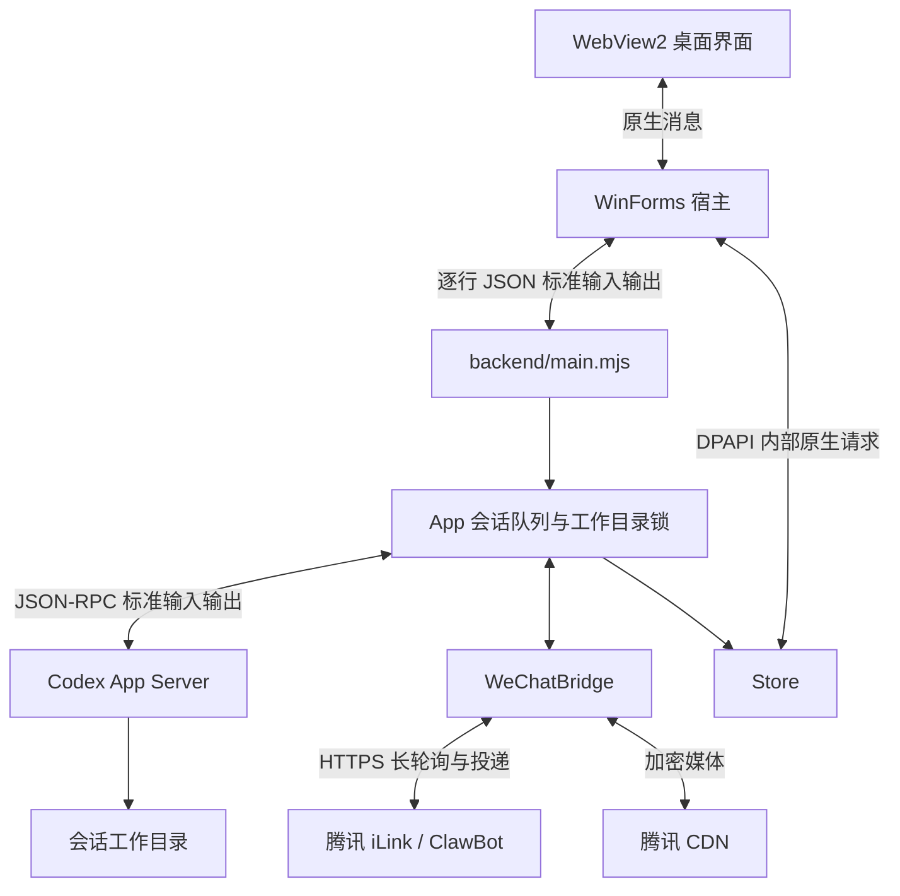

# QQClaw 开发交接与代码索引

## 最新工作范围（2026-11-02）

补充 Windows 内部原生检查已通过：未改动正式 EXE 程序集的入口、前端、后台和 CEF，两次独立检查进程确认面板 X 真正隐藏原生窗口、约150%缩放不覆盖关闭按钮，并在重新调用入口后恢复会话/中文草稿。使用项目外检查宿主及内部 DOM 事件，仍不代表外部物理输入和全部独立 EXE GUI 通过。源码与成品继续 0.3.41，最新证据入口在 result.md 最前节。

本次交付 Windows 0.3.41，入口 release/QQClaw.exe。按用户要求停止后续 Mac 适配，保留现有 DMG；除非后续明确要求迁移，不继续 Mac 探查分支。Windows 验收范围与仍未完成事项见交付说明.md和result.md最新节；下方保留历史证据，不据历史中的后续计划自动扩大本轮工作。

## 当前状态：0.3.41（2026-11-02）

两端同名成品已更新。本轮修复浏览后无法创建报告的实际问题，没有修改界面、官方扩展、官方运行库或其文件沙箱。完整目标继续active，原Windows进程95560未停止，原微信账户没有启动或收到本轮测试消息。

根因与修改：生产App/Bridge/WeChatApi配合真实模型和包内官方浏览组件，实际在Google搜索并核对了三条新闻；模型保存报告时却在浏览器Node REPL使用fs.writeFile，得到EPERM，附件未生成。backend/official-browser.mjs原指引“只使用mcp__node_repl的js工具”范围过宽。本轮把该限制明确限定于网页访问与操作；工作区文件、代码和报告使用Codex原生文件/命令工具，继续遵守当前会话目录与读写权限，先创建和核验文件再返回附件动作。

复测完整保留三阶段：第一轮真实Google读取成功但附件失败；修改后重新搜索时Google要求真人验证，该轮失败，没有绕过或改用其他网页驱动；随后恢复同一个真实Codex thread 01a19a38-2885-7261-88d2-116ee37a5d60，沿用此前已读取的来源，在绑定工作区用原生命令创建AI热点.md并成功完成模拟微信原生文件投递。没有将它称为修改后一次全新搜索到附件的完整通过。

报告3079字节，SHA256 0f655c4457404adda8bcc3015d35176af4a6a983b6a06be4082cec765bdf1c0d。生产上传协议的AES密文在本机CDN接收端解密后与工作区报告逐字节一致，明文MD5/大小、文件卡片中文名、len和AES Key编码均核对通过。实际返回1个原生文件卡片，输入状态有开始与结束；进度1条，各context内推送client_id不超过10条。同会话桌面消息在微信任务期间入队并最终完成，桌面专用标记未出现在微信投递内容中。

范围：使用实际已配置模型，没有夹具模型响应；腾讯请求及CDN由隔离的127.0.0.1 HTTP服务承接，检查的是生产请求序列化、轮询收件、授权回复、执行、进度、加密上传和文件卡片，没有声称腾讯线上接收或手机显示通过。原账户配置只读选取模型，原账户未启动。

Windows0.3.41空数据/系统PATH下使用包内Node v24.22.1启动真实后台通过，检查进程已退出。Mac云运行[41382706673](https://github.com/mumuhaha487/wechatclaw/actions/runs/41382706673)成功，原版官方输入、双配置归属、实际Swift主程序绑定、弹出页/查找/下载内容、加密保存/退出与Universal编译、签名、DMG校验通过。Mac官方浏览组件仍仅arm64，未Apple公证。

两端构建源码：657f255bc5db9c3f455c7bfc5f295cf72ad08b68，97个代码输入与Git副本一致（只规范化LF/CRLF）。Windows 307445248字节，SHA256 2b3c9f1f820027fdd6fc9152e69230c0cf744e424118f2922ef7c4d777ed6505；Mac 537127251字节，SHA256 90340f6e368c448390ece13da7164727dd86763346eb6c0f4393d2b5c5833783。

证据根：C:\Users\admin\AppData\Local\Temp\qqclaw-wechat-browser-18deeadf。首轮result.json/events.json/wechat-wire.json；retry为Google验证阻断；resume保存原会话恢复、真实命令、加密投递和桌面隔离的通过结果；integration-proof.json组合核对了三个阶段。package保存两端构建、源文件核对和交付回执。初次宿主Windows --import路径错误保留在bootstrap-path-error.txt，不计为产品故障。

未完成项保留：Google重新搜索被真人验证阻断的这一轮、腾讯线上微信整条链路、Mac官方tabs.new新普通窗口内嵌、Intel官方自动浏览、官方Blob下载与全部参考主页/物理GUI/输入法/DPI核验。没有使用替代自动浏览驱动，也不把局部检查当成整体验收。

以下为历史记录，不覆盖本节。


## 历史状态：0.3.40（2026-11-02）

本轮改动及针对性检查已完成，两端同名成品已更新。完整目标继续active；不能把本轮验收扩大成线上微信及所有平台全部通过。原Windows进程95560未停止，原微信账户未启动或发送测试消息。

修复ui/app.mjs的官方扩展状态：启动检测和浏览面板使用同一个按会话保存的结果；合并同一会话的并发检测；检测期间的新连接事件优先，迟到快照不能覆盖；设置页不再读取其他会话残留的全局连接状态；未知状态显示待检测。打开、收起、关闭及回包不会改变用户的面板选择。backend/codex.mjs的clientInfo版本改为读取package.json，避免版本提示落后。

本轮真实前端检查通过：已内置组件显示待验证；人为延迟一条状态查询，收到新的已连接事件后再返回旧快照，界面仍为已连接；第二个会话在自身检测返回前显示待检测，未继承第一个会话的连接；两个并发入口只发出一条挂起查询；面板关闭后检测回包未重新打开它。连接状态及延迟RPC是明确夹具，不作为官方自动浏览证据。

另经真实App和官方Codex进程运行两轮隔离对话，上下文从待统计变为3.9%、10.1%；第二轮last=26100、total=36200、窗口258400，界面使用本轮last。服务端响应和usage由本机Responses夹具提供，不是线上模型计费检查。运行中可编辑18行草稿，切换会话并后退可恢复，完成回包后输入焦点/光标和撤销记录仍在。该检查先于连接状态修复执行，上下文算法与输入保留代码本轮未改。

Windows0.3.40在空数据、系统PATH下使用包内Node v24.22.1启动真实后台，检查进程已结束。Mac云运行[41378758379](https://github.com/mumuhaha487/wechatclaw/actions/runs/41378758379)成功：原版官方输入/中文事件、双配置归属、实际Swift主程序连接、弹出页/查找/下载内容、加密保存及退出，以及Universal编译、签名和DMG校验。官方浏览组件仍仅arm64，Mac未Apple公证。

两端构建源码：f514315f849de371b3d6a014050968c8aa238902，97个代码输入与Git副本一致（只规范化LF/CRLF）。Windows 307444736字节，SHA256 5cebe302435fc38a370ec7dffbe8f297fb392df6f8b9e87ac8869d454f8439e4；Mac 537131519字节，SHA256 8820586642bf4c97f0be432e5bb36611916e5d5b252355c67c82343e109a391d。

证据目录：C:\Users\admin\AppData\Local\Temp\qqclaw-homepage-326e0f8f。主要文件：context-ui.json/png、context-backend-audit.json、connection-ui.json/png、connection-backend-audit.json、standalone-verification.json、source-match.json及Mac云artifact。主页逐项操作与代码入口见[HOMEPAGE-PARITY.md](docs/HOMEPAGE-PARITY.md)。Git副本用户修改的docs/CODEX-WEIXIN-LICENSE.txt未覆盖或提交。

未完成项保留：Mac官方tabs.new新窗口内嵌、Intel官方自动浏览、官方Blob下载、线上微信完整闭环与全部参考主页/物理GUI/输入法/DPI核验。当前官方claimTab预备页接管通过，不宣称tabs.new通过；没有引入替代自动浏览驱动。

以下为历史记录，不覆盖本节。


## 历史状态：0.3.39（2026-11-02）

项目内同名 EXE/DMG 已更新，Node/npm 与原版官方浏览运行库内置。完整目标仍为 active。未停止旧 Windows 进程95560，未启动原微信账户或发送测试消息。项目内没有新增检查产物或第二份成品。

本轮修改：浏览器移除常驻连接说明行，工具栏精简为48px；官方扩展状态和配置入口移入“更多”菜单，加载进度线跟随工具栏位置。运行环境页修正“不内置Node.js”的过期文案；两端原生宿主报告当前Node是否来自包内，界面据实际结果显示。Windows一键安装Codex明确使用用户固定的 %APPDATA%/npm，避免全局CLI安装到随版本清理的内置Node目录。Mac原有 ~/.npm-global 目录继续保留。

实际检查：1280×720的真实前端/App/Store中，聊天约583px，右面板约367px，网页视口高562px，无横向溢出；常驻说明已移除，未知/已连接/未配置的菜单入口可用，配置入口确实打开运行环境页。面板关闭后30次后台状态更新仍保持关闭，再打开恢复浏览器标签。浏览器、连接、模型和环境为明确界面夹具，chat.send=0，前端/服务器异常0；一项预设无模型端点错误被正常处理，不计为产品真实服务故障。

Windows新包已在空数据目录、仅系统PATH下由包内Node v24.22.1启动真实后台，隔离进程已关闭。直接调用新EXE中的真实InstallCodex方法和包内Node，命令接收夹具核对了 install -g @openai/codex 与持久化npm前缀；没有联网安装、修改用户现有CLI或声称网络安装通过。

Mac云运行 [41375301038](https://github.com/mumuhaha487/wechatclaw/actions/runs/41375301038) 成功：原版官方DOM输入/实际中文input事件、截图、关闭和退出；两个真实独立配置归属；实际Swift Host加载本轮前端和空后台，原版prepare连接、链接弹出页、查找/焦点、关闭标签后的完整262144字节下载、加密保存和正常退出。新增实际nodeBundled/Node路径检查通过。Universal主程序与双架构Node/npm编译、签名和DMG格式校验通过；官方浏览组件仍仅arm64，未Apple公证。以上不能扩大成微信线上或物理输入法/DPI验收。

两端构建源码：7ae9ae460a02efc3fdcb3ad69b259dab12c28661；97个代码输入与Git副本核对一致（只规范化LF/CRLF）。Windows 307444224字节，SHA256 30d83d5b83f025421f67e8de5412cc53b1d29d8b090edfbfde48b4f5dd7876be；Mac 537017788字节，SHA256 289370545e0a87cf559e199c81b2b0fa920dffc3877bb69ebdd7465892c9e327。入口与数据位置见[交付说明](交付说明.md)。

证据目录：C:\Users\admin\AppData\Local\Temp\qqclaw-ui-039-c5ac68bd。UI截图与审计、真实打包安装方法核对、空目录启动和源码核对均在此。Mac证据artifact SHA256 2ba1f79fc9b8a2c016efed413fc14d4c67863a1d091721d6aaaa02f175ff4c19；安装包artifact SHA256 791f148fb3dd312e0c253985e86ef4f21e4eb93d4d7659456764e95efa27067f。Git副本用户修改的docs/CODEX-WEIXIN-LICENSE.txt未覆盖或提交。

待完成：Mac官方tabs.new新窗口内嵌、Intel原版浏览组件、官方Blob下载能力缺口、线上微信完整闭环与参考主页全部操作/物理GUI核验。现有官方claimTab接管本会话预备页可用，不宣称tabs.new已通过。没有引入替代自动浏览驱动。

以下是历史记录，不覆盖本节。


## 历史状态：0.3.38（2026-11-02）

同名EXE/DMG已更新，运行库内置，完整目标仍保持active。Windows307443712字节；Mac537152609字节，Universal主程序，官方浏览组件为arm64。摘要及安装入口见交付说明。旧Windows进程95560未停止，原微信账户未启动或发测试消息，原数据未清理。

最新构建源码be09963ecdec11fb9514dcf61aa2f020bfa8a689，云检查41372684855整体成功：官方DOM中文输入实际事件、截图/关闭/退出，两个真实配置归属，主程序实际官方prepare连接、原版工具点击链接打开弹窗并正确选中，网页查找/实际firstResponder，关闭下载页后262144字节完整保存，加密历史/设置落盘与正常退出。Universal双架构编译、签名/DMG检查通过。Windows0.3.38空数据/系统PATH包内Node与后台启动通过；不等于真实模型、微信或物理输入检查。

关键入口：backend/official-browser.mjs、macos-official-runtime.mjs、macos-browser-transport.mjs、macos-browser-identity.mjs；native/cef/macos/CefBridge.mm；native/macos/QQClaw.swift、CefRuntime.swift、BrowserHost.swift（CefBrowserController）；scripts/macos-browser-runtime.mjs、macos-official-mcp.mjs、build-macos.mjs；.github/workflows/macos-official-browser.yml。

CEF固定156.0.15+gcf671c0+chromium156.0.8078.80，正式接口设置本应用独立浏览器钥匙串项；原Vault、mac1:AES-GCM及原数据目录不变。临时--vault-key子进程方案已删除。新配置等OnRequestContextInitialized完成后创建视图；每个Chrome视图保持自己的CefWindow生命周期，只移动现有WebKit应用界面。输入检查使用实际documentation提供的原版locator.fill，仍断言网页input事件，不依赖可选AX能力。

下一步：官方tabs.new新窗口嵌入、Intel原版浏览组件、线上微信完整闭环、Blob官方能力缺口和完整物理GUI/IME/DPI。不能因本轮组件通过宣布整体完成。不要借用开发聊天、Desktop、外部浏览器身份/管道或改用替代驱动。

本轮证据根C:/Users/admin/AppData/Local/Temp/qqclaw-mac-official-link-20261102。集成证据artifact SHA256 4b33dc389ef1a23532d9b99d659d01ff10e3b073e25828d076796cade78583bb；最终包artifact SHA256 5f73a656e4b8ff0e960e59b9462f55941d2ffea3cf26e068efa01d9fe3a471be。源码主目录D:/project/QQclaw，Git副本C:/Users/admin/AppData/Local/Temp/qqclaw-cloud-mac-20261031/source。Git副本用户修改的docs/CODEX-WEIXIN-LICENSE.txt不得覆盖或提交，SHA256 BFCB86ACF7015CC4D7F76AB0C1E8B9450F293D259AE9BD051FD4ABAA795F7EBB。

以下是历史记录，不覆盖本节。

## 当前状态：0.3.37（2026-11-02）

本轮只改主页交互，没有修改原版官方扩展或引入其他驱动。ui/app.mjs保留侧栏滚动/焦点和菜单锚点，拖动时延后绘制以保留指针捕获，增加普通会话展开/收起与侧栏右键/键盘菜单；ui/desktop.css修正完整6px分隔线命中区和拖动动画。版本文件与Codex clientInfo同步0.3.37。

实际前端/App/Store的列表、菜单、设置往返、两侧拖动遇到后台更新、关闭和还原检查通过；原生浏览/环境/模型发现为夹具，0chat.send及0前端/服务端异常，不当作新官方模型或微信验收。Windows内置运行库包独立启动通过；Mac云[41343117836](https://github.com/mumuhaha487/wechatclaw/actions/runs/41343117836)成功、46条实际PASS。同名EXE/DMG与[GitHub草稿](https://github.com/mumuhaha487/wechatclaw/releases/tag/untagged-2a2c9cbf4e2a5718fa13)均已更新，构建源码2e392d71a2f9d1cc92c9f236e740b91442a06de1。

完整目标继续active。Mac官方自动浏览、Blob官方下载、微信完整闭环、完整原生GUI/输入法/DPI及参考主页全部操作核验等缺口保留。详细证据与摘要以[本轮记录](result.md)和[交付说明](交付说明.md)为准；以下是历史记录，不覆盖当前状态。

## 当前交付状态：0.3.36（2026-11-02）

两端安装文件已完成并更新到项目内唯一成品：release/QQClaw.exe 与 release/macos/QQClaw.dmg。Windows 内置 Node/npm、CEF、原版官方 ChatGPT 扩展与官方浏览运行库；Mac 内置双架构 Node/npm。原始完整目标仍为 active，不宣称全部验收通过。

- Windows：307438592 字节，SHA256 b482eb04d3e44715bc206c7e9495f4f21deac133fea15d87a65e1665a3b8ec0c。空数据目录、仅系统 PATH 下已实际启动包内 Node v24.22.1 和后台。
- Mac：129362354 字节，SHA256 3ad94470cdcf4f59a8234225bba52fdb31498f9987574da3241e683a96f90052；最低 macOS 13.5，Apple Silicon/Intel。云运行 [41339851338](https://github.com/mumuhaha487/wechatclaw/actions/runs/41339851338) 成功，下载档案摘要和 DMG 尾部已核对，46 条实际 PASS，包含钥匙串加密、原生后台重启的草稿/附件恢复。未 Apple 公证。
- [GitHub 0.3.36 草稿](https://github.com/mumuhaha487/wechatclaw/releases/tag/untagged-900d6977fcbca3aeeb9b)：远端与本地摘要一致，只有一个 EXE、一个 DMG；保持草稿，尚未公开发布。构建代码 d9ae586b59945f312267dd6032fd9ef42602f240。
- 已绕过文件占用对更新位置的影响：将运行中旧 EXE 移至项目外临时目录后放入新版，同名成品已核对摘要。没有停止旧 PID 95560，也没有同时启动新版访问原账户数据；现有窗口仍是旧版本，下一次启动项目内 EXE 才是新版。旧映像仅因进程占用暂存，后台清理脚本会在该进程退出后删除它。项目内没有第二个 EXE 或测试文件。
- 真实官方扩展组件已完成 Google“AI 热点”搜索、滚动及可见结果截图，HTTP 零字节下载取得官方保存路径。Blob 下载仍被原版官方运行库明确拒绝，不伪造成功、不使用替代驱动。
- 尚未完成：微信线上完整浏览交付、完整独立 EXE 的物理焦点/输入法/DPI、Mac 官方扩展自动浏览、Blob 自动下载、参考主页全部操作的一致性核验。真实 Google 组件结果不等同于这些项目全部通过。

本节是当前状态；下方保留各阶段原始记录，其中较旧的“未编译”“尚未替换”等描述只适用于当时。文件入口与数据位置见[交付说明.md](交付说明.md)。本轮打包、下载、安装位置更新的证据集中在 C:/Users/admin/AppData/Local/Temp/qqclaw-browser-036-LIwfus。

最新0.3.36源码更新官方Blob下载能力检查指引。真实Google结果与滚动截图、HTTP零字节下载通过；Blob官方API明确不支持，仍未完成，不要再次仅放宽CEF协议就宣称修复。官方商店CRX3签名、功能代码比对及来源片段见result.md首节和上述证据根。Mac 云 41339851338 成功、46 条实际 PASS，Windows 已编译/独立启动通过。

[0.3.35 GitHub草稿](https://github.com/mumuhaha487/wechatclaw/releases/tag/untagged-d3c45ecc8087c6dbf738)已更新，远端摘要与本地一致，最终仅一个EXE和一个DMG；Windows新版位于项目外成品链接，正式旧版未覆盖。

最新源码 0.3.35 已修复刷新丢草稿。backend/composer-drafts.mjs 校验归属并恢复附件，App 提供 draft.read/draft.remember，Store 加密保存并从普通 snapshot 排除草稿；ui/composer-drafts.mjs 按会话/新工作区保存，发送未确认时保留旧草稿。真实前端刷新与发送结果路径、App/Store 重开检查通过，Windows最终包已通过空数据目录/仅系统PATH的独立启动，Mac云46条实际PASS（含钥匙串/原生后台重启草稿检查），Mac同名DMG已更新。成品状态以 result.md 最新节为准；下方“尚未修复/尚未重编译”属于前一阶段。

最新后续源码：ui/app.mjs 精简聊天标题栏、提供单一面板恢复及实际标签计数，项目会话按更新时间折叠为5条，保留选中项；ui/desktop.css 调整计数、展开箭头与输入框圆角。真实前端点击检查见 result.md 首节，尚未重编译安装包。新发现的下一步问题：整页刷新丢失未发送草稿，需要补加密持久化。

## 当前进展：0.3.34 内置运行环境（2026-11-02）

用户已授权内置运行库，原先等待官方离线下载的阻塞已解除，目标保持 active。Windows 项目内 runtime/windows 已备齐原版官方 ChatGPT 扩展、Node REPL、Node/npm、CEF 和编译客户端；完整 EXE 会包含这些资源，不需要另装 Codex Desktop 或借用开发聊天的浏览器。Codex CLI 仍按需安装，登录及第三方 API 配置由用户在软件中完成。

真实模型已通过隔离的实际产品 BrowserHost/CEF/helper 和内置官方组件，完成 A/B 中文输入、官方下载 wait→click→download.path、45 字节内容核验、关闭 B 后实际移除、返回 A 读回。宿主签名/进程归属与唯一管道核验通过，检查进程正常退出 0。没有启动原微信账户、使用替代驱动或复制登录身份。证据位于项目外 C:/Users/admin/AppData/Local/Temp/qqclaw-bundled-034-2yx9Jh/official-verification.json 及 official-probe/。

Mac 最低系统为 13.5，与两个官方 Node 二进制的 LC_BUILD_VERSION 一致。此前 13.3 的声明已修正。Mac 新增内置官方 Node.js 24.22.1/npm 的 arm64 与 x64 发行包，按固定官方 SHA256 校验，按应用运行架构选用，安装 Codex 写入用户目录。Mac 官方扩展自动浏览尚未接通，不把普通 WKWebView 或 Windows 的结果算成 Mac 自动浏览通过。

独立 Windows EXE 已实际通过：全新空数据目录、仅含 Windows 系统目录的 PATH，后台确实由包内 Node.js v24.22.1 启动，已取得“后端已启动”日志；测试进程随后关闭。起初两次检查未通过：首次受旧长路径限制，第二次仅切换 .NET 选项仍不够，现以扩展路径修复；原始失败日志保留。首次解压进度窗口尚未做原生视觉截图验收。

Mac 云构建 [41333393550](https://github.com/mumuhaha487/wechatclaw/actions/runs/41333393550) 成功，45 条实际 PASS，包含包内 Node/npm 在仅含系统目录的 PATH 下运行、两种 Node 架构签名检查，以及既有安装/原生/持久化检查。已下载并核对 GitHub 档案摘要和 DMG 格式。Mac 编译代码为 f895ca054f98ed795b712d2277f7318e9c48f6c2；该构建包含最低系统 13.5 的修正；Windows 成品对应源码 4905d4b646c9f214330468128cbde964c8e56228。

本轮成品：Windows 307437568 字节，SHA256 25359812fb756e73e583c2acbf4f7d18b0f8883288c28efb33a47d6bc7f512d3；Mac 129551912 字节，SHA256 8af3d6c90e405f7ab4fe92cc964c92f3fc13bec790ec5b65d8e0c65871787041。成品暂存项目外 C:\Users\admin\AppData\Local\Temp\qqclaw-bundled-034-2yx9Jh，Mac 子目录 mac-compat/mac-verified，本地同名 release/macos/QQClaw.dmg 已更新。正式程序未停止，项目内未增加第二个 EXE。

[本轮 GitHub 草稿](https://github.com/mumuhaha487/wechatclaw/releases/tag/untagged-9ccec836087975db1b20)已更新为 0.3.34，仅一个 EXE 和一个 DMG，远端文件摘要与本地产物一致。本轮临时应用/浏览器检查进程已全部退出。

完整目标仍有待验证项：独立软件完整 GUI/焦点/中文输入法/DPI、微信线上浏览闭环、Google 搜索结果、Mac 官方扩展自动浏览及 Blob 官方下载。正式 0.3.32 程序未停止、账户与数据未清理。后面的记录属于历史阶段。

## 本轮新增代码入口

| 文件 | 作用 |
| --- | --- |
| `backend/bundled-browser.mjs` | 发现包内官方组件，为会话生成独立原生宿主配置 |
| `backend/official-browser.mjs` | 准备官方插件、验证宿主归属并配置 Codex 的 Node REPL |
| `native/CefBrowserEngine.cs`、`native/cef/BrowserEngine.cpp` | 独立 CEF 会话、私有 native messaging 注册与浏览器进程 |
| `native/Program.cs` | 解压进度、长路径处理、包内 Node 和 npm 安装入口 |
| `scripts/vendor-official-runtime.mjs`、`scripts/official-runtime-artifact.mjs` | 收集本机官方原始组件，验证并导入 Windows payload |
| `scripts/macos-node-runtime.mjs`、`scripts/build-macos.mjs` | 缓存并校验双架构 Node，打包并签名 Mac App/DMG |
| `runtime/README.md` | 本地随项目复制的运行资源说明；大文件不进入 Git |

Windows 本地源码含运行库时执行 `npm ci`、`npm run build`；Mac 用仓库的手动云构建工作流。临时证据和检查脚本全部位于项目外。

> 更新日期：2026-11-02。正式两端成品 **0.3.32**；Windows 已替换并以 Normal 启动，PID 95560。当前源码另有尚未发布的官方扩展接入开发，不能再宣称工作区与 .32 包全部一致。该旧阶段 goal 曾为 blocked；当前已恢复 active、改为内置运行库，完整范围保留，禁止将组件通过扩大为整体完成。

开发方式按用户最新要求：计划先比较最简便的可行方法，优先步骤少、维护成本低的实现；验证围绕改动及实际风险，避免收益很小的重复校验和额外流程。

最新修订：ui/app.mjs的browser-automation处理尊重显式关闭/收起，原0.3.33迟到事件复现失败后已修复并复测。代码f2c36984f33ad5f4075e323ff8a00158f6466645，两端候选已重建并更新原草稿，仅EXE/DMG各一个；当前摘要与下载入口见交付说明.md，证据和限制见result.md首节。正式.32保持，整体goal仍active。

前一候选记录：用户要求收住范围、准备交付。源码0.3.33，一页交付说明.md列明可用功能与未完成项；正式0.3.32及PID95560保留。Blob真实基线120秒超时；只放宽CEF下载规则虽能落盘31字节CSV，官方仍未返回下载对象/路径，因此该实验已撤回，当前C++与已验证16db内核逐字节一致。实验19项安装/19项URL策略检查不等于官方Blob成功；HTTP/Blob零字节用例未执行。证据在项目外blob-stage-ea15e9a440f5494fa04bc949999506d6及两次official-special目录。0.3.33候选已完成：Windows6370816bytes/18388F4D4ACECA97D1213042D11783CA7A110EAA90C05A0906A883CD3D0C27D5；Mac885211bytes/F53AF38E3F3D52D101532AF0F7C44F6DDBED9D9FCAFF0E84552ECBDF05F41DD8。代码c3b608c，Mac云41320446527成功44条PASS，80源码/workflow匹配；GitHub草稿release430668778仅两份资产，均核对远端摘要。详见交付说明.md和result.md首节。正式.32未替换，整体goal继续active，不得称完成。

前一接续：已补整页刷新恢复安装。CefBrowserInstaller保存操作ID/全局递增revision/进度/终态，UI BrowserComponentInstall恢复状态并拒绝旧响应；ui/app.mjs的RPC编号按文档隔离。真实C#安装器+CUA完成刷新后取消、来源校验失败刷新保留、刷新后成功结算，7项控制器及2项实际RPC源码上下文检查通过。主证据为项目外reload-install-fb6088bfb67a412fb1f5b63b53c1db3f/ui-verification.json；本轮没有真实模型/微信任务，不能套用前轮官方浏览实测。最新Windows候选6370816bytes，SHA256 44A9D8CFA2BD0EA34368074A615AE69E033D5E1578C2A8FBEFECF14E3F45996F，正式.32仍保留。旧“整页安装未测”已被本轮覆盖；下一步继续完整参考主页/原生GUI、焦点/IME/DPI、微信/Google、Mac官方组件及CLI新电脑引导。详细范围和检查失误见result.md最新节。

本轮收尾：最终Windows候选package-05b196be05da45e1a68abebba7e9f826，6370816bytes，SHA256 44A9D8CFA2BD0EA34368074A615AE69E033D5E1578C2A8FBEFECF14E3F45996F；59语法/79源码/21payload核对通过。代码bd94b44的Mac云run41316394686成功，44条实际PASS，新增真实qqclaw协议下执行生产getRandomValues编号表达式；云端secure=true且randomUUID同样存在，未复现UUID故障。最终DMG885195bytes，SHA256 A884EBE75831F54802BCAAD31E723D220ACE0EC96AC51B5A02E15E8E8E9F92E4，ZIP摘要/CRC/UDIF及80项产品源码+workflow规范化匹配。namespace-ui另验证最终UI启动/导航/真实组件状态/刷新，0chat.send/未处理错误；安装全过程的CUA证据仍属于前一UUID生成表达式，不能混称。所有本轮检查退出0，3个临时页关闭，正式95560和正式包保留。细节与下一步以result.md首节为准，goal active。

前一接续优先：侧栏改为明确新聊天行、品牌行搜索/通知，收起时保留唯一入口。ui/app.mjs修复前端刷新后原生页还在但标签栏为空：只读现有state、恢复选中项、复核owner/intent，关闭面板优先于迟到响应；另修复新会话只传workspace而丢弃当前第三方模型配置，现传composerConfig四项。ui/desktop.css/icons.mjs提供黑白亮色行/线条图标。native/cef/BrowserEngine.cpp仅追加windowId/windowShown/surfaceShown实际样式诊断，代码未修改官方runtime或替代驱动。

原生阶段visibility-stage-5e2f5c0961fd49f4ba5b85f9500b6a8d，bundle16db43df8376654c0bec29a907bde739。6项独立窗口状态检查通过；原版官方扩展真实模型两轮（hidden/visible Form）15/16调用均完成A/B输入、45字节下载、B移除和A读回。先前要求后台document.visibilityState=hidden的断言不适用于官方运行时：其attachTab启用focus emulation，固定Chromium的EmulationHandler以stay_hidden=false捕获，头文件明确renderer总被告知可见。源码调用链/摘要在official-visibility-source-evidence.json，旧false报告保留，更正只证明模型工作流；物理显示/焦点仍未验证。

CUA界面layout-ui-e1daa...核对拖宽上下限/双击还原、最后标签/面板关闭、草稿及唯一入口；真实App复现并修复全局默认模型空时新聊天报错，新会话实际继承vendor-next-1/ultra。layout-ui-62abd...核对恢复响应迟到不重开关闭面板。上下文回放实际报告4.9→9.8%及未知，另有本轮真实模型34通知4.82→12.53%。候选package-c4d566f0d0c44b8594a1904c39fe0bdd，6367744bytes，SHA256 618F072FDFE557D35C052BCE01B58F183CF265A118C7BD3E8731314D1008F62C；59语法/79源码/21payload匹配。细节、测试局限和待完成项以result.md最新节为准；下文“下一步查可见性”属旧阶段，不能重复以visible断言未通过阻塞。仍优先补完整GUI/权限气泡/焦点/IME/DPI及官方组件新电脑/Mac/微信/Google等缺口，正式包未替换。

最新云结果：代码提交9dd31321c044b7bc09a4cf7f3ecd35552ca5bfa7的Mac运行41311804049成功，43条实际PASS（排除回显/汇总重复），artifact13086240746摘要匹配，阶段mac-verified/QQClaw.dmg为880658bytes，SHA256 10D8719F1557D08D9530164738C605ADC011E8B5CE36CFB23E298E90FD3B03FE。79输入按LF规范化与该云提交一致。它不是Mac官方扩展或用户Mac GUI/IME验收，未公证；正式.32不替换。新Windows候选见上段及result.md。模型/原生/界面检查已正常退出，正式95560保留。本轮创建的7个浏览器检查页已逐个关闭；未对其他页面发出关闭命令，最终标签列表为空，用户原页面是否仍打开未验证。首次本地日志统计漏匹配PASS:的冒号而失败，已修正且保留原ZIP/执行行，不算构建失败。详细当前索引为项目外visibility-mac-verification.json、visibility-cloud-source-match.json、current-visibility-package.json及current-layout-ui.json。

前一接续：本轮只改native/cef/BrowserEngine.cpp及scripts/build-browser-engine.mjs，保留普通Chrome窗口和原版官方扩展。按实际renderer客户区过滤/对齐窗口、发布最终几何状态、容忍1物理像素过扫，并在延迟UI任务中以公共SetFocus同步Chrome标签，复核当前选择/关闭/可见性。不要改成Views/popup后默认扩展能力等价。最终阶段chrome-ui-stage-ed10daf2ba54410a8d12eee0ac8e3037，bundle b5acb7d549ffde5096fbc2621d29e707；项目外candidate package-293d77a25df648bb82bd115fd1d60a33，6369280bytes，SHA256 3EB93F067E215CAABEB990CE82A105C899F2FFCC7CE43F9763845734D7F65EBC，尚未发布。

最终普通页面4尺寸×12原生采样、真实gpt-6.1-sol/xhigh经原版官方扩展12调用完成输入/45字节下载/实际区域、19项原生查找、16项下载历史及活动下载退出后加密记录复查均通过；详见result.md最新节。两个旧真实模型几何失败、新任务重复release崩溃、安装锁拒绝及首轮下载退出未实际触发均如实保留。补充probe-335e54b00f3444b7975fb831f54251d6只第一项通过，新窗口B visible时旧A仍上报visible导致断言超时；GDB只读内部布局为两原生窗口一show=true一false，不能代替实际桌面显示/焦点。不要把计划中的6项当成已通过。下一步优先区分同Chrome窗口标签与跨原生窗口隐藏的可见性语义，并补全GUI/焦点/IME/其他DPI/权限气泡；微信、Google结果、Mac官方内核及CLI新电脑引导等仍缺。正式95560不停止、不替换，不向原微信账号测试；不借开发聊天身份、不改扩展、不用备用驱动。

最新接续（优先于下方旧构建记录）：源码提交10e3124784f91fe1744105d790f82ad0b4d216e7修复同URL刷新保留旧查找结果。ui/browser-find.mjs与app.mjs共用真实导航版本；前端保留query、等加载完重查、抑制迟到结果及未完成组合输入。backend/app.mjs转发/验证版本；Windows WebView2、CEF、Mac WK均发布版本并拒绝过期search/next/clear。证据根仍qqclaw-cef-contract-20261101，本轮refresh-stage-26520b286bb04e7e96bcace94e5cf71d，bundle69f220ac8d73af0bb077d43d7e1bd185。基线probe-79e514...确实刷新后仍1/3；最终probe-61304...的19项原生与CUA自动1/5/关闭不复活通过，probe-a84933...的6项实际WebView2通过，10项受控前端/App handler、119旧回归/59语法/79源码/21payload通过。首次WebView2检查漏browser-page.js而失败，目录和归因保留，不以rootExit0掩盖backendExit1。

当前内核真实模型official-download-89655943690941ce96d86cfb3ea7f592为8次官方Node REPL、一次自动prepare、两次正常确认、45字节与path一致，根正常exit0；检查器最初对合法单引号/带options写法误报，修正语法匹配后仍核对调用顺序及实际文件，见result.md。Mac云run41294195243精确构建10e3124成功，核对38条实际native PASS，含本轮WK刷新隔离；artifact13078152371摘要匹配，未发布DMG在同阶段mac-verified。当前Windows候选package-909947a9142646e89ff22c89f6526297/QQClaw.exe为6304256bytes，SHA256 C33A167B48BC338F5343818344CA70361D59BD7BBD5D8D3DD7894880A93EC4B5。正式0.3.32及原用户数据未改，不再询问退出/替换。

下一步优先处理CEF原生Chrome重复工具栏和参考界面差异；再继续完整GUI/拖宽/关闭/焦点/IME/DPI、原生查找栏协同、微信/Google结果、Mac官方扩展、新电脑仅CLI组件及整页重载安装接续。新同URL刷新缺陷已按上述范围解决，不重复宣称它未检查。整体goal active，禁止子代理或替代官方扩展；测试、截图、依赖、候选和旧证据仍在项目外。

补充当前69f下载回归：probe-12c980c658ce42668875fcccb25707de的16项实际原生检查通过，CUA下载中退出后独立读取8条记录、最新cancelled、720896/8388608字节、无running、摘要不变、根正常exit0。该结果属于当前内核，无须再用旧622e补证。

最新接续以此段及result.md最新节为准，下方3091等构建仅属历史。当前阶段为项目外 `qqclaw-cef-contract-20261101/download-stage-3e2ea88024134b1ebb29798fb93a187c`，bundle **622e037a0ff991781fa918443c12172f**。C++应用关闭先取消下载、等待实际终态再销毁来源页；C#新增exitDelivered，Close必须等Exited/stdout EOF和最终UI通知实际处理。8项受控退出顺序检查先复现失败后通过；probe-f73f2dbb7d99467cbb5ae4ff910fb761的16项实际下载/历史通过，CUA下载中退出后新进程读到8条记录、最新cancelled、720896/8388608字节、无running、存储读取不改摘要，根正常exit0。不要把旧测试先关下载服务器造成的NETWORK_FAILED(20)误说成回调丢失；旧失败与修正解释保留在download-failure-notes.md和result.md。

当前源码真实模型证据为 `official-download-2e51e728f6c6423391812c590c233087`：622e内核、gpt-6.1-sol/xhigh、12次官方Node REPL、一次自动prepare、站点/下载分别确认、路径及45字节实际文件一致、根正常退出。查找复查probe-ac716ead6e9545919887faf774eaabbd的19项原生通过，CUA1/3→2/3及关闭通过，根正常退出。119旧回归/59语法/79源码匹配/21payload核对通过。当前候选为同阶段 `package-14476ace97ba4e47a4a593dda7b4a544/QQClaw.exe`，6291456bytes，SHA256 `5B8198D341DCDEC2BE576EECEAA602D045F8E5FBE725EF11D40D7E558DF7AA46`。候选不发布，不能覆盖正式.32；所有测试、截图、依赖及旧候选保持项目外。后续仍按下文未完成项推进，禁止派子代理、替代官方扩展、借用开发聊天身份或给原微信账户发送测试。

最新接续（优先于下方历史状态）：CEF下载/历史已接到原有BrowserDownloads/BrowserHistory和DPAPI存储；原生快捷键接线完成但真实焦点未验收。改动索引为native/cef/BrowserEngine.cpp、native/CefBrowserEngine.cs、native/BrowserHost.cs、native/Program.cs、scripts/build-browser-engine.mjs，以及backend/official-browser.mjs中的官方下载等待指引。未修改官方扩展。16项下载/历史原生、19项查找回归、27项键位映射、119旧回归、59语法、79源码/候选资源及新进程重开隔离加密记录已检查。映射不是可信按键，全新进程读存储也不是完整软件重启。

最终阶段 `C:/Users/admin/AppData/Local/Temp/qqclaw-cef-contract-20261101/download-stage-09fc43294ea64a529b02a0415c9beed5`；原生/CUA probe-4ff058c6ada64068820f7551ada79556、查找probe-d0d3215872ba4e098ed32210bb5b6e31、独立存储persistence-72ae129baaec4787b07d2ba7d8445a92；bundle3091f164c0638da525f48a960fe5eec0由产品安装器生成。当前未发布候选package-307f01c2739848b5b3f4c7855acec1a5/QQClaw.exe，6239744bytes、E3ABCECC79F562AC552BF4E642238CCBB1C19277BD5A982B4A3E6B30994F8DD9。不要使用旧候选02788b...（缺最后指引）。

最终真实模型官方下载证据 `qqclaw-cef-contract-20261101/official-download-cce0f6511b67488a9dc2e76c9b6c8770`：11次官方Node REPL，一次prepare，站点与下载分别确认，SDK path匹配原生完成记录且45字节一致。此前只点击链接的official-download-38d4...被原版扩展拦截，不能写成功；应登记waitForEvent(download)，不改拦截策略。更早首轮新增空CEF字符串释放确实崩溃，先保存线程栈再清理9个确切检查进程，记录在download-failure-notes.md，不可删掉或归咎输入法。

下一步继续原生Chrome工具栏/完整参考主页与面板外观、实际GUI/焦点/DPI/中文输入法、同URL刷新前端查找状态、原生/应用查找交互、blob/特殊下载、真实微信/Google结果/Mac、仅CLI新电脑官方组件引导和整页重载安装接续。正式.32程序与两端成品仍保持；不再次要求退出或替换。所有测试/依赖/截图/旧候选在项目外，无子代理授权，主目录源码权威，完整结论以result.md最新节为准。

最新接续：CEF查找与首次标签ready已修，改动仅 `native/cef/BrowserEngine.cpp`、`native/CefBrowserEngine.cs`。19项真实原生检查和CUA前端查找通过，119项旧回归、59语法及79源码/候选资源核对通过；当前新bundle `36ffd1afc048e197f1f545f79bbbf905` 由实际产品安装器生成。最终组件证据在 `C:/Users/admin/AppData/Local/Temp/qqclaw-cef-contract-20261101/find-stage-6cf690b891ab46e78091bf1221afa9dd/probe-b540fef4614c44b0a7d4f58d4d961b04`，同级package-a93d86072df746cca89d83cb1af863ea为未发布候选。真实Google冷启动已自动提交查询但被unusual traffic拦截，没有结果，不得写通过；证据cold-google-fe536aeee375440fb540b6fde503d0f9早于本轮修订。失败、完整索引及未完成项以result.md最新节为准。

继续工作时先处理原生Chrome控件外观、快捷键/下载/历史、完整GUI/微信/Google结果/Mac与仅CLI新电脑官方组件引导。不能把查找组件页截图当完整软件外观；不能将Chrome原生查找栏与应用查找栏的交互算已验证；不要重复停止/替换正式.32或再问用户退出。无子代理授权，继续单代理；测试/候选/旧包在项目外，主目录源码权威。

最终源码真实模型复查：证据 `qqclaw-cef-contract-20261101/cold-local-f52fd5db4f874920897b4b7748c48909`，同一新bundle、11次官方Node REPL、一次prepare、一次站点确认，自动新建/读取/关闭本机页通过。根147088、CEF145708、native148336全部正常退出，无确切PID及直接子进程遗留；不代表Google结果/正式GUI/微信/Mac通过。不要重跑Google验证码或替换驱动来改写失败。

**最新源码检查点：** 已增加native/CefBrowserInstaller.cs与ui/browser-component.mjs：设置可按需下载、校验、取消和修复自己的CEF运行库。CefBrowserRuntime严格校验内嵌清单固定URL/档案摘要；CefBrowserEngine持共享lease至真实退出，安装器要求独占，启动失败释放。Program接状态/安装/取消/进度/job及退出等待，build-windows包含安装器。组件安装与官方扩展连接分别显示，不能互相冒充。正式两端仍.32、PID95560未改。

19项真实原生安装检查在项目外qqclaw-cef-contract-20261101/installer-probe-b0c1403a9628436195146363b043eb16，包含真实CDN下载、新bundle安装/实际worker启动、lease互斥、取消/目录保留/缺资源修复；installer-ui-d1ab6935f85e42c7b864d86e467344c5是CUA实际前端/App/Store+原生安装器的取消、重试、页面切换与最终状态检查。其他原生/模型/环境接口是夹具；未做完整EXE、微信/Google、Mac、新电脑官方扩展或整页重载接续安装验收。140JS、59语法及C#启动失败lease释放检查通过。

独立候选installer-package-ffd835d2dc4642b982ba2c8cd1a202b1/QQClaw.exe，6028800 bytes、SHA256 51AF0F153533FE2A8CD495473EB1E82936F0E24EE8835EE4F91EB2662C4C7D6C；资源/payload/安装摘要核对通过但未发布。前轮host-package首次编译被复用覆盖，旧候选原字节未保留；说明见该目录artifact-superseded-note.md和result.md，不可再以旧路径作当前旧候选证明。

**下一步优先检查自动冷启动：** 前轮CEF真实模型运行前曾人工点击准备，尚未覆盖新会话直接自动准备/native host启动时序。新运行库安装已不依赖手工复制，先用本轮安装的9b583538e14c9ea979b46e630b09472e组件跑完全自动准备，再跑真实模型/Google；只能等待自己所属host，不借其他pipe或重发操作。官方仅CLI的新电脑插件/Node REPL/宿主引导仍未完成：官方文档走桌面设置，空CODEX_HOME无认证的plugin list为0/0，仅CLI有plugin add命令不证明可安装。随后补CEF样式、查找/下载/历史/快捷键、真实GUI/微信/Mac和参考主页。

**此前BrowserHost检查点：** CEF已接实际BrowserHost、Program退出/焦点/job、正式OfficialBrowser helper，以及可选Windows打包。CefBrowserRuntime从程序集QQClaw.browser-engine固定组件摘要与安装目录；scripts/browser-engine-artifact.mjs验证构建源码与产物，build-windows接受--browser-engine及项目外--output。backend/official-browser核对engine/family/能力，codex仅凭本任务官方成功工具结果标连接。未发布，不要把.32包与当前源码混同。

实际产品组件host-integration-2552e209e5ff4dab96ea84b084d7514e（项目外qqclaw-cef-contract-20261101）使用gpt-6.1-sol/xhigh真实调用原版扩展9次，新建/读原文/关闭/再列确认通过；混合标签、后台恢复、空组重开、两会话隔离、重复关闭与迟到操作拒绝也已检查。根/后台正常退出0，A/B各4个renderer受限/低完整性/job检查通过。不是完整GUI、微信、Google、Mac或安装验收。本轮未导出surface几何统计，不沿用前轮2次/499×599。模型运行后又收紧连接状态归属并修启动校验失败时并发请求无限等待，分别由真实事件回放和C#失败探针覆盖，未再跑真实模型。119+18+3项JS检查及58脚本语法通过，最终候选资源与四个二进制摘要已核对。

**此前接续优先级（历史）：** 当时尚缺运行库安装器，本轮已提供并做上述组件检查；仅CLI官方资源准备、新CEF查找/下载/历史/快捷键/控件样式和完整GUI/微信/Google/Mac仍缺。禁止用其他驱动代替官方扩展。

启动证书失败已定位：官方bootstrap检查它与相邻chrome_elf/客户端的签名身份必须一致或同时未签名，之前误用minimal bootstrap加signed chrome_elf。现采用固定同版本minimal的未改配套bootstrap/chrome_elf，libcef保留signed档签名及摘要，没有剥签或绕过检查；产品整体仍未签名。正式唯一EXE/DMG及PID95560未改。项目外host-package候选6010880 bytes、SHA256 5476B370F866D911E533DE2816D2DDC7489FD758F3BB3BE8062FD01187D18D91，不能发布。

**此前组件记录（历史）：** surface-component-f3ed1f62791d433c8827e14c9def2228 当时未接BrowserHost，测得480×400/780×600、200次合并2次及最终499×599；它的源代码、二进制及验证范围与本轮不同，不能互相替代。

first-pass曾有可选on-device-model服务的AppContainer可执行文件读/执行权限失败，已读固定Chromium源码定位，仅给项目外公开运行库目录加定向ACE，未改私有profile/配置/日志及项目；SDDL保留。最终未复现但没有触发该服务，不能判功能通过。最初扩展自动打开公开安装/登录页；最终QA以空allowedOrigins阻止，预期拒绝与无效Chrome外部注册项日志保留。所有组件已正常结束，正式PID95560和唯一两端包未改；不要再次要求退出或将组件编译写成发布完成。

**前一原型检查点：** 项目外 CEF C API 已接通原版官方扩展的新建普通窗口；采用匹配版本官方 bootstrap/DLL 方案启用 Windows 沙箱，实际核对 6 个 renderer 为受限、完整性 RID=0、处于 job 内。真实配置 `gpt-6.1-sol/xhigh` 经官方扩展完成新建标签→localhost 读取→关闭→再次列出为空；10 次官方 Node REPL 调用、1 次网站确认、0 Responses 夹具请求/独立搜索/shell 调用。全部检查组件已正常退出。**该原型当时尚未写入产品或发布包**，不能把“组件成功”改写成正式软件的新标签/完整 GUI/微信/Google/Mac 已通过。

接续目录：`C:/Users/admin/AppData/Local/Temp/qqclaw-cef-contract-20261101/`。真实模型证据为 `real-model-sandbox-official-probe-1113015a71f4411c85c0e75c05d22875/verification.json`、`qa-result.png`、`official-page.jpg`、事件/结果与 sandbox-token-audit.json；协议沙箱为 `sandbox-official-probe-34e1f1669d654af29ccc88b421b74439`，无沙箱原型为 `official-probe-4fd70d1303604dafb5a462bb035d7f3d`（原 QA/result 误沿用 WebView2，已在 verification 更正）。实验源码/版本摘要见 provenance.json、失败见 failure-notes.md，详细实现与边界见专项文档首节。本轮只更新三份交接文档，没有新增项目测试/依赖、没有改变成品或重启正式程序；旧 119/10 项回归未在本轮重跑。

CEF 固定提交 `14c5a089e8452874cb1a556dc3fde26ed2d87723`，版本 154.0.34/Chromium 154.0.8037.98，API15400/hash 与 sandbox compatibility hash 严格匹配。客户端通过 RunWinMain 接收真实 sandbox_info，缺失则退出，无无沙箱回退。实验 helper 保留官方签名/父子链，固定核对 worker EXE、客户端 DLL、libcef.dll；产品 helper 未改成支持 CEF。组件注入 tabCreation=true，产品仍 false。当前 NuGet libcef/minimal bootstrap 的 Authenticode 为 NotSigned，不能把官方来源摘要说成签名有效。network utility 默认不受与 renderer 相同的令牌限制；导航白名单不是完整网络隔离。

下一步：把有沙箱的 CEF worker 实际接入产品面板/标签/焦点/尺寸/取消/下载/查找与每会话独立 profile，然后验证关闭最后标签/面板、切会话/删除/退出及微信全过程，解决可信安装/签名与 Mac。不能因为看到 CEF 的 API 返回成功就跳过普通窗口样式/工具栏、产品标签映射或实际 UI 检查。真实上下文的 10 个旧事件另存 real-context-evidence.json：4.9%→9.8%，最后 last=25410、window=258400、累计 total=199577；这是事件复核，非本轮新 UI 验收。

最新浏览器实现、真实组件证据、文件索引及未完成项见 [docs/OFFICIAL-BROWSER-INTEGRATION.md](docs/OFFICIAL-BROWSER-INTEGRATION.md) 开头及 [result.md](result.md) 首节。真实配置模型 `gpt-6.1-sol/xhigh` 已通过产品 App/Bridge 与隔离微信 API 接收指令、经 `/allow` 继续、用应用内原版官方扩展读取本机页并返回结果；Responses 不是夹具，微信 API 与保存接口仍是夹具，不能称为线上微信或正式 EXE GUI 验收。此轮为 0 独立搜索、0 命令抓取，typing 开始/结束及队列清理已检查。项目不含 vendor 浏览器实现，仍依赖本机已安装官方运行资源。

自动新建标签实际仍失败：原版扩展查找普通窗口，WebView2 暴露弹出窗口，接管已有标签后调用 `tabs.new()` 仍报窗口无 ID。运行指引和状态已明确披露，不能把操作已有专用页称作修复。Google 曾实际输入并提交查询后遇到验证码，未取得结果；该次还受用户全局 AGENTS.md 影响发生一次无关首相搜索，整次不判通过。产品随后增加 `web_search="disabled"`，实际 CLI 配置与修复后隔离微信模型检查均已验证；没有修改全局 AGENTS.md。Mac、新电脑官方组件安装及过长数据路径问题仍未解决。

当前 119 项既有回归与 10 项边界检查通过。Windows 开发源码已在项目外 `qqclaw-host-contract-20261101/development-build` 完成编译（manifest 仍 .32），没有安装或发布；正式 .32 成品保持原摘要。确认表单已完成 CUA 填写、无效值、刷新/切会话保留、拒绝/同意及溢出检查。所有测试和失败记录均在项目外；旧 TAP 原始失败日志曾被运行器覆盖，已记录证据限制并修复运行器，不可再宣称原始输出完整保留。

官方扩展专项调查见 [docs/OFFICIAL-BROWSER-INTEGRATION.md](docs/OFFICIAL-BROWSER-INTEGRATION.md)：含实际读取的官方文档、扩展/native host 静态证据、可信运行环境及每任务授权校验定位、证据摘要与未完成项。该专项调查阶段仅更新文档；不能把安装检测、transport connected 或 SDK 自建 driver 当作官方自动浏览验收通过。

## 0.3.32 最新索引和现场

**替换已完成：** Windows 正式 PID 95560，runtime 6C87004412749884；Mac 同名包也是 0.3.32。原 1 个账户、1 条保留身份、3 会话/134 消息与 Provider 均保留。下面“待 PID 150564 退出”的段落属于此前现场，不能再当成当前阻碍。完整证据见 result.md 最后“Windows 正式替换完成”。

新增 ui/website-cards.mjs：仅将助手完成消息中的独立安全 HTTP(S) 链接转为网站卡片；ui/app.mjs 的 markdown(value, websites) 缓存按展示模式分别保存，文件预览不转换。website-menu/preview/external/copy 绑定源会话/目录，主按钮只调用既有手动 BrowserViewer。ui/message-search.mjs 排除卡片装饰，保持原始标题可查；ui/desktop.css、ui/icons.mjs 负责亮色卡片及本地线条图标。

119 后台回归、19 URL 边界、52 脚本语法及 CUA 菜单/路由/复制/查找/文件预览/两尺寸长标题/过期 owner 检查通过。UI 用真实 App/Store，原生浏览器和 shell.open 为夹具，不能冒称正式 EXE 或官方扩展验收；0 chat.send、0 client/server 未处理错误、3 预期 models.list 错误。证据在项目外 qqclaw-v0332-20261101，失败和范围见 result.md。

Windows 0.3.32 候选 SHA-256 AEBFAC2BCBEF57EF5225B6E36D16BE88C3CCE9A723AFB3209B84459D1ACEE875，尚未正式替换；Mac 唯一 DMG 已更新，云运行 41260465009 成功、42 条执行 PASS，head eb5cbfc2aaff7779041888632680d47161dc17f4，62 文件源码一致。0.3.31 替换脚本在用户回复后实际仍检测到旧 PID 150564，未改正式程序。当前原生 UI 控制禁用，只能请用户正常退出；若其报告窗口已消失，再调查退出路径。后续不要把“已退出”回复直接当成进程确实退出。

本轮项目外 replace-when-exited.ps1 -Install 已核对语法及候选，仍只返回等待 PID 150564 退出。新脚本使用 Normal 启动用户主程序，且在复制后核对实际资源和新后台；不得把未执行分支写成已经验证。当前窗口状态问题仍待答案，不重复问更新授权。

官方浏览器 attestation 补查已写 docs/OFFICIAL-BROWSER-INTEGRATION.md；授权/连接仍未打通。原始 goal 保持 active，禁止借用开发聊天权限或用其他远控方案替代。

## 0.3.31 历史状态与输入栏索引

输入栏只有一个“访问权限”菜单，合并原“工作模式/执行权限”重复入口；模型服务、模型和思考等级收进一个模型菜单。后台权限仍限制工作区，没有把 UI 文案改成未经实现的全盘访问。模型列表继续按 Provider 动态刷新，可以手填未知模型 ID。

新增 `ui/composer-model.mjs`：管理菜单位置、关闭/焦点、运行门禁、源会话与异步保存归属、第三方服务的临时配置。选新第三方服务后，选定或手填模型才原子保存 provider/model/effort；无模型发现接口也能完成，取消则保留原配置。`ui/app.mjs` 提供当前选择、目录和 RPC，`updateComposer(change, origin)` 显式绑定原会话；`ui/controls.mjs` 支持限定区域关闭、模型刷新焦点和权限说明；`ui/desktop.css` 控制亮色菜单及长名称边界。

119 项后台回归与 51 个 JS/MJS 语法检查通过。CUA 使用隔离前端与真实 App/Store，验证普通/无列表服务、手填 ID、动态列表替换/失败、模型思考等级、默认配置、跨会话待完成保存、权限切换及四尺寸长名称布局；不是正式 EXE 全套 GUI 或真实微信/模型请求。详细范围与失败记录见 `result.md` 文末，证据目录为项目外 `C:/Users/admin/AppData/Local/Temp/qqclaw-v0331-20261101`。

最终代码 head `cad385e948cb8f75d4200d9aba5312290441d974`；Windows 候选 SHA-256 `B43FD474015437ED105544DA78F17F981A93593499EA14D1092BA27C7541841B`，预期 runtime `AF81BDB8CCFC3E60`。运行中的正式 0.3.30 不强杀；待用户正常退出后，用本轮项目外 PowerShell 7 `replace-when-exited.ps1 -Install` 重新备份/核对后替换。Mac 最终包、云运行和源码核对见报告，不能采用前一中间 head 的产物。官方扩展自动浏览及主页全部 1:1 仍未完成。

## 0.3.30 历史功能与索引

Windows `release/QQClaw.exe` 已在用户正常退出后更新为 0.3.30；Mac 同名包与最新云运行见 `result.md` 文末。更新后原 1 个账户、1 条保留身份、3 个会话/134 条消息及 Provider 配置核对一致。不要再使用下方历史中的 PID 115392 或“等待退出”作为当前状态。

| 索引 | 职责 |
| --- | --- |
| `shared/goal.mjs` | 原生目标快照、4000 字符校验、可选正整数预算、状态文案 |
| `backend/codex-answer.mjs` | 跨原生回合监听、恢复竞态、最终状态、阶段进度与全部阶段附件汇总；不设置任务超时 |
| `backend/codex.mjs` | 原生 goal/get/set/clear；监听先于 thread/resume；停止先暂停目标；用户附件上下文与当前权限/思考等级 |
| `backend/app.mjs` | 目标全过程工作区锁及文件快照；`goal.fromMessage/set/get/resume/clear`；`goalMessageIndex` 关联；目标控制不重发用户消息 |
| `backend/conversations.mjs` | 便携备份保存目标、源消息索引、阶段消息和各次运行目标统计；目标不等于伪造原生 rollout |
| `ui/app.mjs`、`ui/icons.mjs`、`ui/desktop.css` | 输入区目标模式、消息下设目标、状态/统计卡片、暂停/继续和预算详情 |
| `.github/workflows/macos.yml` | 目标全过程、控制操作不重发 turn、阶段附件、备份及已有 macOS 原生检查 |

真实独立 Codex 0.157.1 已验证原生目标创建/完成、跨回合、暂停/恢复、冷恢复、源附件进入模型上下文、备份恢复、替换目标重新计量和任意模型名。119 项后台与 23 项生命周期检查通过。微信接口为隔离夹具，验证 12 回合对应 6 条过程、1 条省略通知、1 条总结和 2 个文件共 10 条；桌面任务不会推微信。没有向原微信会话发测试消息。

检查与旧包都在项目外 `C:/Users/admin/AppData/Local/Temp/qqclaw-v0330-20261101`；源代码 head `c1c092b3a6a41e8ce6a0ef3d0f398b0215066af1`。Windows 正式启动仅核对新后台、版本资源、日志和数据；CUA 是隔离前端/真实组件检查，不冒充独立 EXE 全套 GUI。详细摘要、失败及 Mac 最终证据见 `result.md` 文末。未改无关的 `docs/CODEX-WEIXIN-LICENSE.txt`。

官方扩展自动浏览仍未接通。当前目标功能不能补齐官方浏览器可信宿主或授权；禁止借用开发聊天管道、普通远控、自建 MCP/CDP/HTTP 或伪造授权。主页全面 1:1 仍有差异；原始 goal 保持 active。

## 0.3.29 历史状态

补充核查：无文字截图a705b10b的本地文件时间为2026-11-01 01:54:06，显示0x8000000E；它对应0.3.25章节已按同码复现并修复的异常，不应在上下文压缩后再次当成新崩溃。已重新读取原复现堆栈，确认为CoreWebView2Deferral.Dispose/Complete重复结束；当前代码仅finally内Dispose一次。正式0.3.26既有21项新窗口回归及正常退出后无COM日志证据保留，不能写成本次重跑。当前PID115392仍在、正式日志无native.log，不足以证明所有GUI路径健康；没有强制退出或替换。

新调查读取了官方Codex固定提交67f0994b532b8740f14b5b738af7b7b2a915b1d6的Code Mode host/runtime及原生目标实现，详见docs/OFFICIAL-BROWSER-INTEGRATION.md“公开Code Mode宿主源码复查”。公开V8执行器不自动提供浏览器的privileged nodeRepl/nativePipe，且拒绝模块导入；单独编译该host不能补齐授权。目标API会触发自动后续回合，现有单回合answer监听/工作区锁尚未适配，不要只加按钮。安装版0.157.1的goal/set无origin字段、resume无deferGoalContinuation；不得直接套用最新main或fork字段。本次只更新文档及项目外调查证据，没有产品代码修改、新构建或新增功能验收。

Mac 唯一安装包已更新为 0.3.29；Windows 0.3.29 候选已编译，正式 EXE 仍为 0.3.26（PID 115392），等待用户正常退出后替换。

本版实际修复慢网页阻塞整个会话：App.browserOperations改为每会话未完成请求Set；两端原生按页固定目标/串行/取消，控制命令不排在网络加载后。UI.runBrowserCommand携带选中tabId并更新导航意图；移除会话先dispose再等请求集合。Windows BrowserTab.Serial/OperationRevision/AwaitCompletion，Mac BrowserHost按tabId操作及BrowserWindow的WKNavigation对象/continuation负责隔离迟到回调。两端显示URL与真实文档URL分开，待加载地址不会假写历史。

最终13项导航、11项恢复协议、13项原生Find、13项CUA前端/真实组件、119项后台、40项Mac云执行输出；证据都在项目外qqclaw-v0329-20261101，失败基线和范围见result.md文末。不是独立EXE整套GUI/原生焦点可信按键验收。代码head 3b2149fc620df44a7eeb383f5dc4bf9577aa7163，云运行41246304291。

官方接入继续未完成。项目外qqclaw-official-probe-20261101记录空Home的独立0.157.1实例：initialize成功，浏览器feature flags稳定且启用，但没有授权连接或浏览器操作；167个公开实验客户端方法未找到browser连接方法。这不是所有技术路径不可能的证明。下一步核实自身可信Code Mode/官方浏览器服务契约；禁止以其他工具、假宿主、始终允许授权或开发聊天身份替代。原图1/3的“目标/设为目标”入口也仍未实现。

Windows候选待原进程正常退出后再执行项目外PowerShell7 replace-when-exited.ps1 -Install；运行中只检查，不强杀。此前退出问题仍待回复，不重复请求授权。Mac同名安装包已更新，发布目录不加旧包或测试文件；原账户、目录、threadId和消息已核对保留。

## 0.3.28 历史状态

Mac 唯一安装包已更新为 0.3.28；Windows 0.3.28 候选已编译，正式 EXE 仍为 0.3.26（PID 115392），等待用户正常退出后替换。

查找入口按聊天/工作面板的实际焦点分派。索引：ui/app.mjs 的 findRegion/find-current、fileFind/browserFind、原生快捷键事件；ui/message-search.mjs 的 MessageFind 文档模式；新增 ui/browser-find.mjs 的迟到结果/输入法/焦点保护；backend/app.mjs 的 browser.find；Windows BrowserTab.Find/AwaitFind 与 Mac BrowserWindow.find/close 负责真实查找和关闭/新查询取消；Mac Host.menuCommand/validateMenuItem 先检测 focusedPage。scripts/build-windows.mjs 临时生成 BuildInfo.cs，统一版本。

严格基线关闭查找30,014ms超时；修复后24ms返回stale，最终13项原生检查通过。CUA前端/真实组件22条加最终11条，后台119项，Mac云实际34条；不冒充完整独立EXE GUI或原生焦点可信按键。证据、文件摘要、失败和限制详见 result.md 文末。

代码head f911c69a54e4c22353d77c6d5402a985b66d5124，云运行 41242626394。Windows待退出后执行项目外 PowerShell 7 脚本 C:\Users\admin\AppData\Local\Temp\qqclaw-v0328-20261101\replace-when-exited.ps1 -Install；先检查状态并重新审计，切勿在仍运行时覆盖。尚未实际替换，不能填写已启动。之前正常退出问题仍待回复，不重复提问。

官方扩展目标仍未完成，禁止增加远控/MCP/HTTP替代方案或借用开发聊天身份，禁止向原微信会话发测试消息；本轮不更改 Codex 原生对话保存位置。

## 0.3.27 历史状态

Mac 唯一安装包已更新为 0.3.27；Windows 候选已编译，正式 EXE 仍为 0.3.26，等待用户正常退出后替换。

新增 ui/closed-panel-tabs.mjs 保存每个会话/目录最近 20 次成功关闭的位置元数据，串行恢复、防重复、失败可重试及删除会话时清理；不缓存旧文件正文。ui/panel-tabs.mjs 的 place 恢复混合标签位置。ui/app.mjs 的 closePanelTabs/reopenPanelTab 先核实原生关闭，再记录历史，读取真实文件或调用 restoreTab；异步结果核对 owner、panelIntent、模态/菜单及真实标签对象。网页先在后台建立，仅在原操作仍有效时显式 selectTab。

ui/application-menu.mjs 动态刷新可用状态并保留活动菜单焦点；ui/panel-tab-actions.mjs、加号和 Ctrl/⌘+Shift+T 走统一恢复。Windows BrowserHost.Restore 在 EnsureReady 前清除旧停止标志，等待后检查新停止请求；原生 Ctrl+Shift+T 加入有限快捷键分发。Mac QQClaw.swift 增加显式 command+shift+t 菜单与 canReopen 状态。backend/app.mjs、backend/browser.mjs 仅增加手动 restoreTab 白名单及 URL 验证；没有开放模型浏览器自动化。

本轮实际证据为 25 条 CUA 承载的产品前端+实际 App/Windows BrowserHost 组件检查、停止修复后正常恢复检查、11 项原生接口、7 项恢复状态、119 项核心回归和 Mac 31 条实际 PASS。CUA 检查跨候选迭代，受影响场景已修复重测；不是完整独立 EXE 的 GUI/原生焦点按键检查。Mac 新快捷键是菜单组件派发，未实机按键。57 份代码/样式/页面/版本/工作流匹配本地构建副本及云 head。完整范围、失败和成品摘要见 result.md 本版章节。

关闭恢复仅在进程内；审阅/文件管理器工具页和网页自行关闭不进入此历史。网页只恢复地址，不恢复 POST、未提交表单、整段前进后退历史。官方扩展授权/自动浏览、全部主页 1:1、Mac 网页查找/完整 GUI/输入法、公证等目标仍未完成。不得将本阶段写成整体通过。

<!-- end-qqclaw-0327 -->

## 0.3.26 历史状态

本轮补齐原生网页焦点下的应用快捷键。0.3.25 隔离基线证实真实点击网页后 Ctrl+T 不增加标签；0.3.26 最终 22 项真实键盘检查覆盖新建/关闭/切换标签、地址栏、侧栏/面板、搜索/设置/新聊天、普通网页输入与撤销、后台刷新和空标签组焦点。普通页面合成事件不能触发宿主快捷键，错误 owner/tabId 的聚焦请求被拒绝。

索引：native/BrowserHost.cs 的 BrowserTab.KeyDown / BrowserHost.Shortcut / Focus；native/Program.cs 的 browser-shortcut 通知与 window.focusBrowser；ui/app.mjs 的 focusPanelSelection / workspaceKeyboardAvailable / syncNativeMenuState、browser-new-tab / browser-focus-address / panel-close-active / panel-next-tab / panel-previous-tab；ui/browser-history.mjs 的焦点与建议处理；ui/application-menu.mjs 的标签/地址入口；native/macos/QQClaw.swift 的菜单及分发前 first-responder 切换；native/macos/BrowserHost.swift 的 owner/tab/visible 聚焦验证。

正式两端均为 0.3.26，Windows 已正常重启（PID 115392，app/D6D04A747374777E）。341 项 Windows、119 项核心、28 条实际 Mac PASS；62 文件候选/云源码匹配，Mac 成功 run 41230961068，head bef58590793366ff43a8c634b897e4cd06b3a882。原 1 个连接账户、1 条断开身份、3 会话/134 消息、目录绑定、threadId 和 Provider 比较保留。全部材料在项目外 C:\Users\admin\AppData\Local\Temp\qqclaw-v0326-20261101，release 只一个 EXE、一个 DMG。

关闭最后工作标签后允许显示空工具选择器，原生标签必须为零，不自动重建；面板全局叉另行关闭整个面板，键盘空组操作后回到聊天输入框。Mac 菜单/聚焦检查属于真实 AppKit/WebKit 组件，未作可信实机键盘/输入法验收；⌘F 仍是会话查找。官方扩展自动浏览仍未接通，不能宣布整体完成。完整指纹、失败与范围见 result.md 最新章节。

## 0.3.25 历史状态

本轮修复网页真实新窗口与用户截图同码的原生异常。`native/BrowserHost.cs` 的 `NewTab` / `OpenWindow` / `CloseTab` / `BrowserTab.EnsureReady` / `NewWindowRequested` / `WindowCloseRequested` 负责同 Environment 的未导航 WebView、新页回交、关闭和请求完成；deferral 仅在 finally 中 Dispose 一次。`native/Program.cs` 用 FirstChanceException 观察 COM 堆栈，记录至用户数据 logs/native.log，不吞掉默认异常。`native/macos/BrowserHost.swift` 的 newTab(configuration:) / closeTab / createWebViewWith / webViewDidClose 保留 WebKit 原始 configuration，由 WebKit 自己加载目标请求。`ui/app.mjs` 的 updateBrowserState 跟随原生新标签，不抢文件/工具选择、后台会话或已关闭面板。

两端正式成品均为 0.3.25，Windows PID 155296，运行资源 app/3704D9A7B2AC5F2A。62 份候选源码逐字节匹配；Mac 成功 head e1166079cf58dfcedb8af0e599681166560c8184（run 41227468490）对应源码按换行规范化匹配。最终 319 项 Windows 检查、119 项核心回归、26 条实际 Mac PASS；包含 21 项新增原生新窗口流程和正常退出后无 COM 日志核查。账户、目录绑定、断开身份、threadId、3 会话/134 消息及 Provider 比较保留。项目外材料：C:\Users\admin\AppData\Local\Temp\qqclaw-v0325-20261101。唯一成品指纹、根因、失败和验证边界见 result.md 最新章节。

网页框继续使用上版顶部对齐、28.7% 默认窗口比例、拖动/双击恢复和关闭逻辑。官方 ChatGPT 扩展仍未接通，不可将本轮手动网页新标签验收当作微信自动浏览成功；Mac 脚本组件检查不等于用户完整 GUI、可信鼠标或输入法验收。

## 0.3.24 历史状态

最新反馈“两个网页框大小占比不一样”已经落实到 DOM 布局：`ui/app.mjs` 的 `content-area` 内并列 `conversation-pane` 与工作面板；会话标题、Desktop/环境提示条和聊天仅占左列。`ui/desktop.css` 使右侧标签从主体顶部开始。`defaultPanelWidth` / `applyPanelWidth` / `resetPanelWidth` / `syncPanelDimensions` 管理默认 28.7% 窗口比例、上下限与聊天剩余空间；拖动后的像素宽度跨重启保存，双击分隔线删除该偏好并恢复响应式比例。窄窗口保留可关闭覆盖面板。白色为主、黑色为辅的偏好不变。

新 `ui/browser-history.mjs` 管理地址联想、键盘选择和浏览记录弹窗；`ui/app.mjs` 连接网页工具栏/设置入口、原生事件及历史导航前清除该标签地址草稿；样式在 `ui/desktop.css`。Windows `native/BrowserHost.cs` 的 BrowserHistory / NavigationCompleted / DocumentTitleChanged，Mac `native/macos/BrowserHost.swift` 的 BrowserHistory / didFinish / title KVO 保存成功访问及后续标题。原生路由在 `native/Program.cs` / `native/macos/QQClaw.swift`，`browser.history` 提供 state/remove/clear，事件 `browser-history` 用单调 revision 防止旧状态覆盖。没有开放模型调用此接口。

历史独立文件 `browser-history.json`：Windows DPAPI 使用 entropy `QQClaw/browser-history/v1`，Mac 使用现有 Vault/Keychain/AES-GCM；与主 state.json 和下载历史分开，原子写入。仅接受无凭据 HTTP(S)，去 fragment，同一 URL 保留最近一次，最多 500 个不同 URL；同一系统用户在 QQClaw 内跨会话共用，不按微信身份隔离。管理界面每批 50 行，搜索覆盖全部记录，地址建议最多 6 条。取消清除不修改；清除只删记录，保留 Cookie、文件、消息。读写失败提示原因并保留原文件；普通浏览仍可用。加载后标题只更新现存记录且保留 ID/访问时间，删除后不会因标题更新重建。未承诺所有 SPA pushState/hash 导航、完整 Cookie 管理或模型申请访问历史。

两端正式成品均已替换为 0.3.24，Windows 正常退出后重启。最终候选 298 条 Windows UI/原生集成检查、119 项核心回归通过；Mac 成功 run 41223051740（代码 ea341c16895c120a19e782ed56dfae376edc8714）实际 24 条 PASS。账户/目录绑定、断开身份、原 threadId/逐条消息、Provider 比较保留（1 个连接账户、1 条断开身份、3 会话/134 消息）。微信/Codex 后台及主存储源码本轮未改，backend.cjs 摘要与 0.3.23 相同。本轮全部测试、截图、依赖、备份和旧成品在项目外 `C:\Users\admin\AppData\Local\Temp\qqclaw-v0324-20261101`；`release` 仅一个 EXE、一个 DMG。完整指纹及失败说明见 `result.md` 最新章节。

官方扩展自动浏览仍未完成。MCP Events 文档的触发范围是 Work web / Desktop 的 Cloud / dots，并未提供本地 Codex 外部消息触发口；desktop-only stdio 插件文档提供本地工具，但没有提供第三方宿主浏览器授权接口。allowlist 限制的是目录提交，不能写成所有本地插件都被禁止。不要借用当前开发聊天令牌、管道或使用其他远控替代。Mac 尚未 Apple 公证或用户整套 GUI/输入法/线上微信验收。不要将本阶段进展写成所有目标通过。

## 0.3.23 历史状态

保持白底、浅灰侧栏、黑灰文字及图标。原生下载管理见 `ui/browser-downloads.mjs`、`native/BrowserHost.cs` 与 `native/macos/BrowserHost.swift`；UI入口和事件接线在 `ui/app.mjs`，样式在 `ui/desktop.css`，原生 RPC 路由在 `native/Program.cs` / `native/macos/QQClaw.swift`。侧栏和关于页版本由 package.json 构建导入，避免显示旧版本。

`browser.downloads` 仅供桌面UI调用，动作 state/cancel/clear/open/reveal；事件 browser-downloads 含全局单调 revision，避免旧状态覆盖新状态。打开/显示文件使用已记录的不透明ID，不接受调用者提供的路径。下载历史保存在用户数据的 browser-downloads.json：Windows 使用单独 entropy 的 DPAPI，Mac 使用现有 Vault/Keychain/AES-GCM；与 state.json 分开保存。文件使用系统 Downloads/QQClaw 下的独立目录，文件名去除路径和非法字符。QQCLAW_DOWNLOADS_DIR 仅用于隔离检查。

下载记录独立于会话；关闭标签或移除会话时保留必要的原生视图到下载终态，再释放。应用重启把遗留 running 标为 interrupted，提示在原网页重试；未实现自动续传或暂停。文件记录损坏/保存失败时保留旧文件并阻止覆盖，仍允许取消内存中真实在途下载。clear 只清终态记录，不删文件。Windows 对同一导航的下载重试替换 .NET wrapper，不取消同一个原生下载；Mac 明确处理转下载的 WebKit policy 102，避免误报加载失败。

这是手动网页预览的原生下载功能，不能当作官方扩展自动操作已接通。官方宿主授权、网页批注、网站权限和完整历史/全部主页1:1仍有差异。最终两端成品、实际检查数量、失败材料和数据保留结果以 result.md 最新章节为准，项目内只保留唯一EXE/DMG，检查和旧包在项目外。

## 0.3.22 历史状态

0.3.22：文件/网页标签支持拖动排序、鼠标中键关闭和右键菜单（关闭、关闭其他、关闭右侧、复制路径/地址、文件夹显示或系统浏览器打开）。Shift+F10打开菜单，方向键/Home/End选项，Escape/Tab关闭并恢复焦点。关闭其他会包含当前文件管理器/审阅工具页；异步关闭始终绑定原会话和实际标签对象，不会误关另一会话。

新增 `ui/panel-tab-actions.mjs` 管理菜单、焦点、拖动捕获/取消和中键；`PanelTabs.move` 只调整所属会话的混合顺序并保留对象/选择/阅读状态。`ui/app.mjs` 的 `closePanelTabs` 统一单个与批量关闭，通过原生RPC关闭实际网页并在失败时重新读取状态；批量操作期间切换会话仍可正常使用。修复新建原生网页标签时完整刷新清空地址输入的竞争：创建期间禁用地址输入，完成后恢复；每个网页标签单独保留未提交地址草稿，后台刷新和切回标签不丢失，提交后显示真实URL。地址草稿、标签顺序和菜单状态仅在进程内保存。

最终候选完成44条新交互、60条搜索、32条会话、13条布局，共149条真实Windows界面检查，4项标签顺序和119项核心回归通过。两端唯一成品已更新。Mac实际18条PASS中新增真实WebKit组件的菜单/键盘/焦点/门禁/归属检查；不等于Mac产品完整GUI或可信鼠标拖动验收。正式数据保留当前1个连接账户、1条断开身份、3个会话/134条消息及Provider配置。原2账户变化的未确定原因保留在0.3.21记录，未恢复已断开账户。详细成品指纹见 `result.md` 文末。官方扩展授权/自动调用仍未接通，网页批注、完整历史/下载/权限及Mac实机等未完成项不变。

## 0.3.21 历史状态

新增 `ui/message-search.mjs`：只读 `searchSessions` 检索名称/目录、已保存消息和附件名；`SessionSearch` 管理分页、纯文字高亮、键盘及结果身份核对，结果不变时保留节点；`MessageFind` 提供跨Markdown节点的完整计数及前后循环，只为当前消息所选匹配附近最多201处创建标记，4000处密集匹配已实测；独立段落/附件边界分组避免假匹配。`ConversationView.reveal` 展开并定位原消息，不改正文或模型配置。

`ui/app.mjs` 接入Ctrl/⌘+K/F、顶部省略菜单和覆盖面板/设置页处理；`ui/application-menu.mjs` 及 Mac `native/macos/QQClaw.swift` 增加编辑菜单入口，Mac通过hasSession禁用无当前会话的局部查找。已修复覆盖面板关闭按钮被查找栏遮挡及新省略菜单立即消失的问题。

60条新搜索、32条会话、13条布局真实EXE检查，8项搜索语义和119项核心回归通过。两端唯一同名成品已更新，正式替换/数据保留、Mac实际17条PASS和成品指纹见 `result.md` 文末。官方扩展、网页批注/完整历史/下载/权限仍未完成；Mac未用户实机完整GUI/输入法/线上微信验收、未Apple公证。白色为主、黑色为辅的亮色偏好继续保留。

最终数据复核为1个连接账户、1条已断开身份记录、3个会话、134条消息。缺少的原账户ID/用户身份与retainedAccounts完全对应，记录仅含身份，不含登录令牌；当前源码只有显式wechat.disconnect路径会移出账户并写该记录，启动迁移不会移出账户。该状态与断开连接流程一致，但现有日志没有调用者/时间审计，不能确定是谁何时断开，也不能将其写成原2个连接账户均保留。原会话/threadId/逐条消息、剩余账户目录绑定及Provider URL/Key比较均通过；没有恢复已断开账户。安全比较见项目外account-audit.json。

## 0.3.20 历史状态

最新直接消息“要以白色为主，黑色为辅，整体亮色”覆盖此前黑色为主的偏好。`backend/store.mjs` 默认 light，appearanceVersion=4 将旧外观一次迁移到亮色，之后主动选择暗色或系统主题仍保留；`ui/index.html` 和初始 state 同步亮色，Windows 原生 Form/WebView2 与 Mac AppKit/WebKit 初始背景均为白色，动态主题切换继续保留。`ui/desktop.css` 使用白底、浅灰侧栏、黑色正文与灰阶强调色。

输入框自动增高前后捕获并恢复当前阅读位置：已经在底部时跟随底部，阅读历史时保留锚点。新增检查先等待实际滚动几何达到底部，避免把长历史尚未结束的平滑滚动当成布局缺陷。32条会话、26条外观、13条布局的真实EXE检查及119项核心回归通过，实际截图已查看；Windows确认空闲后正常关闭、替换、重启，原2账户/3会话/134消息与目录、threadId、Provider保留。Mac云构建41211705711成功，实际16条PASS、下载摘要/CRC/DMG尾已核对，唯一同名DMG已替换。代码提交0c814fc，成品指纹及材料索引以 `result.md` 文末为准。新增交互未在用户Mac实机做完整GUI/输入法/线上微信验收，未Apple公证，官方扩展仍未完成。历史章节的深色偏好不覆盖本节。

## 0.3.19 历史状态

新增 `ui/conversation-view.mjs`：按实际行高折叠超过八行的用户消息，提供显示更多/收起；顶部会话目录按完整用户文字/附件名称筛选，支持键盘及点击定位。原消息全文保留，不改变发给模型的内容。按会话保留进程内展开状态和阅读锚点，普通刷新和切换会话不会复用其他会话的滚动像素；不跨重启保存这些状态。

`ui/app.mjs` 仅接入展示与消息标识，`ui/icons.mjs` 新增目录线条图标，`ui/desktop.css` 提供灰阶样式和窄窗口图标布局。旧响应式样式隐藏全部顶部面板按钮的问题已修复。29 条会话真实 EXE 检查、26 条外观、13 条布局及 119 项核心回归通过；两端同名唯一成品已更新，Windows 正常退出/替换/重启及原数据保留已核对，Mac 云构建 41210396857 成功并核对实际日志和下载摘要。成品指纹以 `result.md` 末尾为准。新增交互未完成 Mac 实机 GUI 验证；官方扩展、完整人工 Mac GUI 和其他未完成项不变。

## 0.3.18 历史状态

Windows 同名唯一成品已替换、重启并核对运行资源和原数据保留；Mac 同版云构建 41208966933 成功，已读取实际验证输出、核对下载摘要并替换唯一 DMG，最终指纹及证据见 `result.md` 末尾。本次用户仍明确要求黑色为主的黑白主题，覆盖旧目标中的亮色文字。图片预览已用宽图/长图/大图、四种窗口和大字号验证；不要把当前黑白配色恢复成绿色。Mac 完整人工 GUI/输入法、公证及官方扩展仍未完成。

`shared/view-preferences.mjs` 白名单校验布局元数据，剔除已删除会话/目录/项目，限制宽度；`ui/view-preferences.mjs` 在首个后台快照后采用加密 Store 的偏好，网页存储仅用于一次旧数据迁移。`view.remember` 立即进入原有原子保存队列，拖动阶段先更新缓存、结束再保存，避免逐像素重写会话文件。UI 恢复当前会话/项目、项目折叠、侧栏宽度/开关、普通面板类型/宽度/开关/展开状态，关闭后重启再展开文件管理器会重新读取实际目录；任务审阅仍由 review.remember 保存更具体的快照选择。文件/网页标签、阅读位置和未发送草稿仍只在进程内。

`App.browserOperations` 按会话串行手动网页命令；停止绕过队列，关闭标签先定向停止同一标签导航，UI 暂不接受关闭中的标签回流。移除会话期间 getSession 拒绝新任务，等待此前网页操作结束后调用两端原生 dispose，释放网页和观察器；清理失败保留会话并报告，正常退出等待该操作。不曾打开网页的会话不创建原生视图。官方扩展仍未接通，本功能不是模型自动化。

## 0.3.17 历史状态

`ui/panel-tabs.mjs` 管理每个会话及目录的混合文件/网页标签、文件 canonical 去重、异步读取顺序和本地链接解析。`ui/app.mjs` 提供共用标签栏、Markdown/源码与行号定位、阅读位置、文件刷新/显示、键盘操作，以及消息 HTTP 链接的用户手动打开。后台网页状态不抢走文件，横向标签滚动在 DOM 刷新后保留；已关闭标签和旧会话的文件返回不重新打开面板。`backend/app.mjs` 的 `workspace.read` 返回 canonical 相对路径，`workspace.reveal` 复用已知工作区及 realpath 边界检查。Windows/Mac BrowserHost 的状态增加单调 revision，UI 丢弃倒序网页状态。

文件上限 16 个、网页上限 12 个；文本预览上限 512 KiB，二进制和越界路径拒绝。混合标签、未发送草稿及文件阅读位置仅在进程内保留；不要与加密 Store 中跨重启恢复的当前任务审阅混淆。Mac 普通视图偏好及网站登录态仍未获得跨重启保证。默认黑白深色、图片等比缩放继续保留。本次是主页交互的阶段改进，官方扩展授权/自动操作、网页批注/下载/历史等缺口仍未完成；最终验证和成品指纹以 result.md 末尾为准。

## 0.3.15 历史开发状态

最新目标及验收报告见根目录 `result.md`。默认深色黑白（appearanceVersion=3，一次迁移后保留主动选色）。右侧工具和手动网页预览面板支持拖宽/键盘/双击、展开还原、关闭与收起；关闭最后标签后保持空组，状态请求不自动创建标签。`shared/context-usage.mjs` 读取 Codex `last` 当前统计，禁止用历史 `total` 累计量计算窗口占用，缺样本显示待统计。

用户现有硬要求是**官方 ChatGPT 扩展**，覆盖此前允许自建工具的决定。`backend/browser.mjs` 已移除 HTTP MCP，仅保留手动 BrowserViewer、独立子进程隔离参数、官方扩展安装文件检测。`backend/codex.mjs` 不再注册自建浏览器，application context 如实说明官方连接未完成，并禁止用其他远控当作达标。官方 Desktop 插件依赖独立授权宿主，公开 CLI 接口未提供连接，详情和证据见 result.md。不得恢复历史章节的自建 MCP 当成官方扩展完成，也不得借用开发聊天的私有宿主身份。

0.3.12 已补充桌面附件导入、粘贴/拖入图片与预览、会话内草稿和应用前进后退；0.3.13 使用黑白深色、原生窗口主题同步和按弹窗剩余空间缩放图片。未发送草稿不跨重启保存。0.3.15 把当前任务审阅的会话、文件选择和面板开关保存到加密 Store，跨 Windows/macOS 重启恢复，不依赖网页存储；切换会话或其他面板会清除旧任务选择。0.3.14 已接入 `backend/checkpoints.mjs` 和 `shared/change-stats.mjs`：任务前后文件快照、真实行数、无 Git 审阅、撤销/重新应用、冲突检查与中断恢复。快照存在用户数据目录；依赖目录、超限工作区、链接/类型互换等限制见 result.md，不是任意磁盘全部可撤销。

0.3.16 源码补齐外侧应用导航、Windows 全局菜单和 Mac AppKit 菜单。主题继续按最新要求使用黑白深色，图片预览等比收进窗口。当前草稿在常规刷新中保留原生撤销记录，并在中文合成输入期间推迟整体刷新；跨页面或会话的原生撤销历史仍未持久保留。验证与成品最终状态以 result.md 为准。

本轮仍为阶段性交付，不能写“全部通过”。下方 0.3.10/0.3.9 等内容保留为历史解释，不是当前功能说明。

## 0.3.10 历史交接：内嵌浏览器、黑白外观与旧会话修复

- 默认主题改为深色，所有应用表面和强调色使用中性黑白灰。首次升级旧外观时切换一次深色，用户以后主动选择亮色会保留（settings.appearanceVersion=1）。
- Windows WebView2 / Mac WKWebView 直接作为主窗口子视图，HTML 提供标签、导航、搜索地址栏；不创建独立浏览器窗口。每个会话最多 12 个标签，账户隔离规则不变。
- UI 通过 browser.view 传递 CSS 视口位置；原生按 DPI / NSView 坐标转换显示页面。隐藏面板、切换设置、打开弹窗/菜单时隐藏网页层；ResizeObserver 和样式/DOM 变化持续校准位置。别用主 UI 的 CDP 截图判定网页空白，它不包含原生子视图；应采集自身窗口或网页工具的实际截图。
- backend/browser.mjs 仅在 QQClaw 的 app-server 子进程关闭 Desktop 专用 browser/unified-computer-use/chrome/computer-use 插件及 node_repl，保留全局 Provider 和其他 MCP，不修改用户配置。CLI 插件 key 不可加字面引号；干净环境中的禁用 MCP 仍需有效 transport。
- backend/codex.mjs 在有浏览器时声明 experimentalApi，并用 turn/start.additionalContext 的 application 类型刷新本轮浏览器说明。不能单靠 thread/resume.developerInstructions 更新已加载旧会话，更不能靠测试提示点名正确工具掩盖选择错误。
- 新增内部 browser.command 白名单用于标签、前进后退、刷新及状态；不允许 UI 传入任意脚本。外部网页依然没有应用消息桥。
- 限定文本、附件、代码及表格宽度，窄聊天栏使用容器查询收紧输入控件；表格和代码在自身区域滚动。不要通过隐藏按钮或裁切文本掩盖布局错误。
- 验证证据及包指纹见 README 当前交付记录；测试、截图、诊断副本、备份和构建依赖继续放在项目外。

## 0.3.9 历史交接：独立浏览器（验收范围不足）

用户最后决定采用 QQClaw 自带浏览器与 Codex CLI，不依赖 Codex Desktop、CodexHost、Chrome 扩展或本开发聊天的私有工具连接。用户只复制/发布本项目，并会在卸载 CodexHost 的新电脑测试。微信发送网页任务后应直接执行，不要求点击接续按钮。

| 文件/入口 | 新增职责 |
| --- | --- |
| `backend/browser.mjs` / `BrowserTools` | 随每个 Codex 客户端启动的随机端口、本机鉴权 MCP；固定工具、参数校验、串行、停止和关闭 |
| `shared/browser-page.js` | 网页可见文字/元素快照，失效 ref 检查，点击、填写、提交、选择、滚动；密码值遮盖 |
| `native/BrowserHost.cs` | Windows 独立 WebView2 窗口；profile 数据存储在应用数据的 `browsers/` |
| `native/macos/BrowserHost.swift` | Mac 独立 WKWebView 窗口，按账户隔离的内存网站会话；兼容 macOS 13.3 |
| `backend/codex.mjs` | 注入自有 MCP，处理该浏览器的 MCP 审批；新建/恢复对话均更新浏览器说明 |
| `backend/app.mjs` | 创建工具服务；`browser.open` 打开会话网页，断开后可重开；权限属于连接签名 |
| `native/Program.cs` / `native/macos/QQClaw.swift` | 内部 `browser.control` 请求路由；网页视图与应用 UI 桥隔离 |
| `scripts/build-windows.mjs` / `scripts/build-macos.mjs` | 编译各平台 BrowserHost，将网页操作脚本嵌入成品 |
| `.github/workflows/macos.yml` | 双架构、DMG 安装验证，并真实检查 WKWebView 输入、提交和截图 |

权限不能简化成伪造只读注解：click/fill/press/select 保持非只读。全自动/旧 workspace-write 仅在当前子进程中预授权这四个自有工具；ask/accept-edits 通过 Codex 的 `mcpServer/elicitation/request` 显示审批；read-only 在发现和调用两层禁止它们。不得全局批准其他 MCP 或伪造 Desktop/CodexHost 身份。`/stop` 会停止网页加载并废弃排队的浏览器调用；任务总时长仍不设限。

Windows 唯一正式 EXE 已替换并重启：589,312 字节，SHA-256 `A57DFE69A7474D7365A928AE45736AFC457AAFCDE2E4897C765DFB77709D7435`。替换前核对无运行、排队或待回复任务，正常关闭；原有 2 个账户、3 个会话保留，0.3.9 运行资源与后台已核对。Mac 唯一 DMG 为 633,978 字节，SHA-256 `2d2c44f037fbfd139dd7432006d52ee744ea08ecd4a4ff0abf884e77e42fdff0`，[云构建与原生验证成功](https://github.com/mumuhaha487/wechatclaw/actions/runs/41188625183)，运行代码提交 `18b9e8a`。测试、依赖、截图、旧成品和备份全部在项目外。

验证：119 项既有回归、24 项浏览器检查通过；真实 Codex 全自动/询问模式完成打开、填写、Enter 提交、读取结果。真实 EXE 从输入框下发任务并显示服务器收到的查询结果，无页面脚本错误。微信 API 使用夹具接收/出站，实际运行 App、Codex、WebView2 和 DPAPI，核对 typing、进度/结果、桌面消息不回微信及原生 Codex 历史；不要声称这是线上微信实发。Mac 云端通过原生网页交互与持久数据检查，完整人工 GUI 和线上微信仍待实机确认。

限制：Google 当前网络实测返回异常流量验证码，程序已如实回报，未取得可核实的热点搜索结果；不能将导航成功写成 Google 搜索完成。浏览器暂不支持自动上传/下载和跨域 iframe 内操作；Mac 的网站登录态不跨应用退出保存，但对话、微信账户、Codex 原生历史正常落盘。旧的“点击 Desktop 中继续才能使用浏览器”说明仅是 0.3.8 历史，不适用于当前流程。

## 1. 新窗口先看这里

QQClaw 是一个 Windows x64 便携桌面编程工作台，并已补充 macOS 13.3+ 原生宿主源码与通用构建配置：用本机 Codex 执行编程任务，也可通过腾讯 iLink / ClawBot 从微信操作项目。尽管名称含 QQ，目前接入的是微信，未实现 QQ 机器人。

技术结构是 **WinForms + WebView2 原生宿主、原生 JavaScript 界面、Node.js 后端、Codex App Server**。没有 React/Vue，也不是 Electron/Tauri。界面资源加载在桌面内的虚拟域 `https://qqclaw.local/`，不提供对外的网页管理服务。

当前 Windows 唯一正式交付物是 [release/QQClaw.exe](release/QQClaw.exe)。Mac 唯一成品改为 `release/macos/QQClaw.dmg`（拖入应用程序安装，包含通用 `.app`），最新状态见第 17 节。源码需要保留供二次开发；用户不希望项目中存在多份 EXE、旧版、依赖目录、测试脚本、测试截图或压缩备份。

建议阅读顺序：

1. 本文的用户约束、消息链路及近期修复。
2. [README.md](README.md)：使用、设置和构建说明。
3. [backend/app.mjs](backend/app.mjs)：应用入口、会话调度、RPC 路由。
4. [backend/codex.mjs](backend/codex.mjs) 与 [backend/bridge.mjs](backend/bridge.mjs)：两条核心链路。
5. [ui/app.mjs](ui/app.mjs) 与 [native/Program.cs](native/Program.cs)：界面及桌面宿主。
6. [docs/ARCHITECTURE.md](docs/ARCHITECTURE.md)、[docs/WECHAT-PARITY.md](docs/WECHAT-PARITY.md)：提取过程、复用接口及微信功能对照。

本文中的函数名可直接用 `rg -n` 搜索。链接采用相对路径，方便整个项目搬迁；源码继续变动后应以函数名定位为准。

## 2. 用户已经明确的开发约束

| 方面 | 必须继续保持的要求 |
| --- | --- |
| 桌面交付 | 后续仍只交付同名 `release/QQClaw.exe`，不要生成带版本号的多份程序让用户选择 |
| 依赖体积 | EXE 不内置 Node.js、Codex CLI 或完整浏览器运行时；界面提供安装、配置入口 |
| 界面 | 以 PI-Desktop 为参照，用户要求完整对齐其布局与交互，不能擅自换成另一套设计；默认亮色 |
| 业务范围 | 保留 Codex 编程与微信入口；不要把 PI-Desktop 的其他 AI 引擎、扩展市场等照搬进来 |
| 微信入口 | 左下角第二个图标为“连接到微信”，使用微信风格线条图标，不贴微信图片代替图标 |
| 账户绑定 | 项目菜单提供绑定微信账号；每个账号有工作目录、服务、模型、思考等级和权限 |
| 两端使用 | 微信会话可以继续在 EXE 内输入；两端均可提交任务。桌面发起的进度、结果和附件只能留在桌面 |
| 模型配置 | 动态读取模型列表；支持第三方 API、Key、任意有效模型 ID 和思考等级，不能写死模型列表 |
| 过程推送 | 微信任务最多 6 条过程消息，达到后发送一次省略提示，等待完成再发总结与附件 |
| 回复额度 | 同一回复上下文最多 10 个消息额度；须给最终结果和文件留位置，不能让过程消息耗光额度 |
| 文件发送 | 本地文件应由宿主读取、加密上传并发送微信原生附件，不能把 `http://D:/...` 当成可下载链接 |
| 验证方式 | 不接受“进程还在所以正常”的交付；涉及执行链路的改动要真正通过 EXE 下发指令并核对结果 |
| 长任务 | 不设置运行总时长上限，不要恢复 30 分钟自动停止；任务等待完成，仍支持用户手动停止 |
| 故障定位 | 卡死时先保存现场、查原因；验证修复后再关闭和替换。不要先杀掉现场再猜测原因 |
| 已取消消息 | 用户此前取消的 4 条微信消息已清理，不要重新发送、恢复或回放 |
| 项目整洁 | 保留源码与必要文档，测试、截图、依赖、旧程序和备份放项目目录外 |

现有布局以 PI-Desktop 为基础。2026-10-31 用户另行授权参照 tasteskill.dev 做一版减少“AI 味”的视觉尝试，可回退；本轮保留三栏和功能入口，调整外观，不代表此前每个像素都已经得到最终验收。

## 3. 项目文件索引

### 3.1 根目录、文档与构建

| 文件 | 职责 |
| --- | --- |
| [开发交接.md](开发交接.md) | 本交接文档：全局入口、索引、功能和接手注意事项 |
| [README.md](README.md) | 用户使用、模型设置、工作目录、依赖安装和构建说明 |
| [package.json](package.json) | 版本、依赖、`dev` / `build` 脚本；Node.js 要求为 22.13.0 及以上 |
| [package-lock.json](package-lock.json) | npm 精确依赖版本；根包版本需随正式版本同步 |
| [.gitignore](.gitignore) | 排除依赖、构建目录、日志、环境文件、覆盖率及 release 内容 |
| [LICENSE](LICENSE) | 主项目 MIT 许可证 |
| [docs/ARCHITECTURE.md](docs/ARCHITECTURE.md) | 两条链路的提取、协议、最小复用示例和宿主通信设计 |
| [docs/WECHAT-PARITY.md](docs/WECHAT-PARITY.md) | codex-weixin 功能对照、媒体发送、推送额度、验证边界 |
| [docs/CODEX-WEIXIN-LICENSE.txt](docs/CODEX-WEIXIN-LICENSE.txt) | 微信移植代码的 MIT 声明 |
| [docs/PI-DESKTOP-LICENSE.txt](docs/PI-DESKTOP-LICENSE.txt) | PI-Desktop 素材的 LGPL-3.0 声明 |
| [scripts/build.mjs](scripts/build.mjs) | esbuild 打包前后端、获取 WebView2 SDK、嵌入资源、C# 编译单 EXE、收集许可证 |
| [scripts/dev.mjs](scripts/dev.mjs) | 先构建，再启动正式 EXE；不是网页开发服务器，也没有热更新 |
| [release/QQClaw.exe](release/QQClaw.exe) | 唯一正式 Windows x64 程序 |

当前项目根目录没有 `.git`，接手时不要假设已有可用的 Git 历史或分支。用户添加的其他工作区是否有 Git 仓库，和本项目目录是否有 Git 是两回事。

### 3.2 后端与共享模块

| 文件 | 职责与主要入口 |
| --- | --- |
| [backend/main.mjs](backend/main.mjs) | Node 进程入口；逐行 JSON 消息、原生调用回执、初始化、单次关闭及进程异常兜底 |
| [backend/log.mjs](backend/log.mjs) | 数据目录 logs/backend.log；脱敏错误与堆栈帧、1 MiB 轮换、总计保留 3 份、写入失败静默 |
| [backend/app.mjs](backend/app.mjs) | `App`；项目、会话、Provider、模型、工作目录、执行队列与业务 RPC |
| [backend/codex.mjs](backend/codex.mjs) | `CodexClient`；程序发现、App Server 子进程、JSON-RPC、thread/turn、审批、模型列表 |
| [backend/adapter.mjs](backend/adapter.mjs) | 第三方 Responses / Chat Completions 转换、本地随机端口及鉴权 |
| [backend/store.mjs](backend/store.mjs) | `Store`；默认状态、迁移、串行原子保存、脱敏快照、错误过滤和目录校验 |
| [backend/bridge.mjs](backend/bridge.mjs) | `WeChatBridge`；多账户登录、轮询、收件箱、会话映射、进度、额度、投递、输入状态 |
| [backend/wechat.mjs](backend/wechat.mjs) | `WeChatApi`；腾讯 iLink HTTP 协议、扫码、轮询、文字及媒体消息 |
| [backend/wechat-messages.mjs](backend/wechat-messages.mjs) | 入站消息标准化：文字、语音转写、图片、视频、文件及音频 |
| [backend/wechat-media.mjs](backend/wechat-media.mjs) | AES 密钥处理、入站下载解密、大小校验、本地媒体加密与 CDN 上传 |
| [backend/wechat-actions.mjs](backend/wechat-actions.mjs) | 解析模型返回的发送动作与本地 Markdown 链接，分离正文与附件 |
| [backend/wechat-format.mjs](backend/wechat-format.mjs) | 给模型的桥接提示、附件提示、历史预览、分块及隐藏桥接指令 |
| [backend/wechat-buffer.mjs](backend/wechat-buffer.mjs) | `PromptBuffer`；多条文字和附件合并、数量限制、过期与取消 |
| [backend/wechat-commands.mjs](backend/wechat-commands.mjs) | 微信斜杠命令、紧急命令分类、模型/思考等级/历史/工作区操作 |
| [backend/wechat-results.mjs](backend/wechat-results.mjs) | 结果投递规划、完整总结与多附件 ZIP、100 MiB 分包、临时包清理 |
| [shared/workspace.mjs](shared/workspace.mjs) | `workspaceKey` / `sameWorkspace`；Windows 路径身份比较，前后端共用 |

### 3.3 原生宿主与界面

| 文件 | 职责 |
| --- | --- |
| [native/Program.cs](native/Program.cs) | WinForms 窗口、WebView2、资源解压、Node 后台、文件选择、依赖安装、DPAPI、进程生命周期 |
| [native/app.manifest](native/app.manifest) | Windows 应用清单 |
| [ui/index.html](ui/index.html) | 页面容器、CSP、样式及打包后 `app.js` 的入口 |
| [ui/app.mjs](ui/app.mjs) | 页面状态、所有主视图、设置、弹窗、交互路由、RPC、事件处理与工作面板 |
| [ui/controls.mjs](ui/controls.mjs) | 自定义选择器：模型搜索、手动 ID、键盘操作、刷新按钮与弹层定位 |
| [ui/model-catalog.mjs](ui/model-catalog.mjs) | `ModelCatalog`；按 Provider 缓存、刷新合并、替换目录、保留失败前数据 |
| [ui/icons.mjs](ui/icons.mjs) | `icon()` SVG 图标集合，包括微信风格线条图标 |
| [ui/app.css](ui/app.css) | 基础样式、主题、组件、布局 |
| [ui/desktop.css](ui/desktop.css) | 在基础样式后加载；PI-Desktop 布局、间距、字体与桌面交互覆盖样式 |
| [ui/assets/home-mascot-light.gif](ui/assets/home-mascot-light.gif) | 亮色首页动态吉祥物 |
| [ui/assets/home-mascot-dark.gif](ui/assets/home-mascot-dark.gif) | 暗色首页动态吉祥物 |
| [ui/assets/home-mascot-still-light.png](ui/assets/home-mascot-still-light.png) | 亮色首页静态素材 |
| [ui/assets/home-mascot-still-dark.png](ui/assets/home-mascot-still-dark.png) | 暗色首页静态素材 |

`backend.cjs`、`ui/app.js`、WebView2 DLL 和图标等是构建产物，打包到 EXE 后解压到用户数据目录，不是漏提交的源文件。

## 4. 当前功能清单与界面入口

| 功能 | 当前行为 | 主要实现 |
| --- | --- | --- |
| 首页与布局 | 吉祥物、项目侧栏、会话区、输入区、状态、右侧面板；亮色默认，支持暗色/系统主题 | `ui/app.mjs`、两个 CSS 文件 |
| 项目 | 添加目录、展开会话、项目菜单、打开文件夹、移除项目、绑定微信账号 | `sidebar`、`projectSettings`、`project.*` |
| 会话 | 创建、切换、重命名、复制会话内容、搜索/历史、移除；保留消息与工具摘要 | `newSession`、`selectSession`、`messages`、`session.*` |
| 编程 | 通过 Codex 读写工作区、执行命令；显示逐字输出、过程消息、工具活动与上下文用量 | `App.run`、`CodexClient.answer`、`composer` |
| 权限与停止 | 只读、每次询问、允许编辑、全自动；桌面审批；停止当前任务 | `permissionPolicy`、`approval.respond`、`chat.stop` |
| 文件引用 | 输入栏添加本地文件路径引用交给 Codex，当前不是独立的拖放上传系统 | UI `attach-file` |
| 文件面板 | 浏览工作区目录、文本预览、返回上级、刷新；预览上限 512 KiB | `workPanel`、`workspace.list/read` |
| 审阅面板 | 查看 `git diff HEAD`；依赖工作区有可用 Git 历史和系统 Git | `workspace.diff` |
| 浏览器面板 | 输入 URL 后在系统浏览器打开；当前不是内嵌网页浏览器 | `open-browser`、`shell.open` |
| 通知 | 对每个仍存在的会话检测忙碌结束；后台会话也通知，重复状态不重复通知 | `onEvent("state")` |
| 通用设置 | 主题、字体、字号、计数/活动/时间/状态等显示偏好 | `generalSettings`、`settings.save` |
| 模型与 API | 本机配置、自定义服务、地址、Key、协议、模型、思考参数及默认值 | `modelSettings`、`provider.*` |
| 环境设置 | Node/Codex 检测、手动路径、官方安装链接、一键安装 Codex、登录、重启 | `runtimeSettings`、原生 `system.*` |
| 首次配置门禁 | 未配置环境时提示“当前环境未配置 Codex 环境，请在设置中进行配置”，由“前往配置”进入 | `setupGate`、`environmentReady` |
| 微信账户 | 左下角入口显示已连接账户；扫码、验证码、多账户、配置、暂停、重连、断开、查看会话 | `renderOverlay`、`accountCard`、`WeChatBridge` |
| 绑定工作区 | 项目“…”菜单中选择微信账号，更新该账号目录及配置 | `workspaceBinding`、`bind-workspace-account` |
| 微信消息 | 私聊文字、转写语音、图片、视频、文件、未转写语音附件 | `wechat-messages`、`wechat-media` |
| 微信输入状态 | 处理期间显示“正在输入”，续期；完成、失败或关闭时取消 | `startTyping`、`config`、`typing` |
| 微信过程与结果 | 6 条过程上限、省略提示、10 条额度、最终总结、原生附件与必要时 ZIP 打包 | `progress`、`flushProgress`、`sendReply`、`planWeChatResult` |
| 双端会话 | 桌面与微信共享会话和 thread，可继续输入，任务排队；仅微信来源回传微信 | `App.enqueue`、`processNext` |
| 多发送者 | 额外授权用户 ID，各自会话、上下文、历史编号及模型覆盖相互隔离 | `senderSessions`、`sessionFor`、`handleCommand` |

没有把右侧文件预览实现成完整代码编辑器，也没有集成独立终端、插件市场或 PI-Desktop 的其他模型引擎。当前“编写代码”主要通过 Codex 执行任务实现，后续开发不要误把尚未存在的能力当成已有功能。

## 5. 核心函数与类索引

### 5.1 应用、Codex 与存储

| 模块 | 重点符号 | 作用 |
| --- | --- | --- |
| `app.mjs` | `normalizeModels`、`connectionOptions` | 模型元数据统一和连接参数校验；不以固定模型列表限制第三方 ID |
| `App` | `init`、`changed`、`getSession`、`newSession` | 初始化、脱敏状态广播、会话访问与创建 |
| `App` | `client` | 按会话缓存 CodexClient；配置变化时更换，空闲 15 分钟且无任务、审批或活动 turn 时回收 |
| `App` | `enqueue`、`run`、`finish`、`stop` | 会话排队、目录互斥、工具事件/历史、结果存储、取消 |
| `App` | `readModels`、`loadModels`、`reapIdleClients`、`handle`、`close` | 模型请求按服务合并、闲置客户端回收、业务 RPC 总路由与资源关闭 |
| `codex.mjs` | `findCodex` | 显式路径、活动桌面运行程序、新安装目录、PATH/npm 等 Codex 发现 |
| `codex.mjs` | `providerArguments`、`codexEnvironment`、`permissionPolicy` | 进程级 Provider 参数、父会话环境隔离、权限转换 |
| `CodexClient` | `connect`、`open`、`send`、`request` | 子进程建立与 JSON-RPC 收发；初始化握手 |
| `CodexClient` | `models`、`thread`、`runtime`、`answer` | 分页模型列表、thread 创建/恢复、实际配置、turn 执行 |
| `CodexClient` | `interrupt`、`close`、`dismissApprovals`、`respondApproval` | 停止、退出、容错清理审批、人工审批回传 |
| `adapter.mjs` | `validateBaseUrl`、`toChatRequest`、`toResponse`、`responseEvents` | 服务地址校验、工具与消息格式转换、Responses 事件生成 |
| `adapter.mjs` | `createChatAdapter`、`createResponsesAdapter` | 临时本地兼容代理；第二参数为选项对象；Responses 支持 `{ fetchImpl, idleTimeoutMs }`，默认 240 秒上游空闲超时 |
| `store.mjs` | `defaults`、`Store.init/save/flushSaves/snapshot` | 初始状态、迁移、合并尾随的加密原子保存、隐藏凭证的 UI 快照 |
| `log.mjs` | `createLogger` | safeError 传入所有 Provider Key；只写错误消息和前 5 个堆栈帧，拒绝记录 Codex stderr 原文 |
| `store.mjs` | `safeError`、`workspacePath` | 错误内容脱敏、绝对路径和真实目录验证 |
| `shared/workspace.mjs` | `workspaceKey`、`sameWorkspace` | 大小写、斜杠和末尾分隔符归一后的身份比较；不改写显示路径 |

### 5.2 微信链路

| 模块 | 重点符号 | 作用 |
| --- | --- | --- |
| `WeChatBridge` | `init`、`status`、`changed` | 恢复账户与状态、迁移发送者元数据、状态广播 |
| `WeChatBridge` | `startLogin`、`createLogin`、`loginLoop`、`verify`、`cancelLogin` | 二维码和验证码登录状态机，登录请求合并 |
| `WeChatBridge` | `getAccount`、`update`、`disconnect` | 账户管理、配置变更、断开与历史身份保留 |
| `WeChatBridge` | `accountSessionIds`、`accountBusy` | 检查号主、额外发送者、待投递引用和相关会话，不能只看 `account.sessionId` |
| `WeChatBridge` | `sessionFor`、`createSession`、`activateSession` | 按账户/发送者寻找、创建、切换会话 |
| `WeChatBridge` | `ingest`、`promptItems`、`processNext` | 入站筛选去重、附件准备、命令/编程与持久投递 |
| `WeChatBridge` | `context`、`replyBudget`、`replySlots`、`waitingForContext`、`sendReply` | 最新上下文与持久回复预算，稳定 client ID，等新上下文继续 |
| `WeChatBridge` | `progress`、`flushProgress`、`startTyping` | 过程去重与限额、“正在输入”生命周期 |
| `WeChatBridge` | `startWorker`、`pollLoop`、`deliveryLoop`、`close` | 轮询与投递分离，退出停止后台循环和输入状态 |
| `WeChatApi` | `request`、`qr`、`qrStatus`、`updates` | HTTP 公共层、扫码、状态、长轮询 |
| `WeChatApi` | `config`、`typing`、`send`、`upload`、`sendMedia`、`sendItems` | 输入状态、文字、上传地址、原生媒体消息 |
| `wechat-messages` | `normalizeWeixinMessage` 等 | 将腾讯消息条目统一为文字和附件 |
| `wechat-actions` | `parseActionBlocks`、`parseActionBlocksSafe` | 原严格解析保持上游语义；业务入口逐块逐条容错并返回 discarded 数量 |
| `wechat-format` | `buildPrompt`、`buildPromptPreview` | 模型输入及桌面任务预览 |
| `wechat-format` | `parsePrompt`、`stripBridgeInstructions`、`chunkText` | 保留的上游移植函数，运行时当前无调用点，仅对照测试使用；不是界面渲染函数 |
| `wechat-media` | `parseAesKey`、`encryptAesEcb`、`decryptAesEcb`、`aesEcbPaddedSize` | AES-128-ECB、密钥编码、填充大小 |
| `wechat-media` | `downloadInboundAttachments`、`downloadInboundAttachment`、`prepareLocalMedia`、`sendLocalMediaFile` | 下载解密、入站路径、出站文件读取加密、上传回执 |
| `PromptBuffer` | `start`、`append`、`done`、`cancel`、`isActive`、`expire` | 多条输入的会话级缓冲 |
| `wechat-commands` | `helpText`、`commandOf`、`urgentCommand`、`handleCommand` | 命令说明、解析、优先命令和实际处理 |
| `wechat-results` | `planWeChatResult`、`cleanWeChatResult` | 按剩余额度安排总结/附件/ZIP，完成后清理生成包 |

### 5.3 界面与原生宿主

| 模块 | 重点符号 | 作用 |
| --- | --- | --- |
| `ui/app.mjs` | `markdown`、`markdownCache` | 固定 MarkdownIt / DOMPurify 配置，按文本缓存已净化 HTML，500 条 LRU |
| `ui/app.mjs` | `rpc`、`state`、`ui` | WebView 原生消息调用；持久状态镜像与本地交互状态 |
| `ui/app.mjs` | `sidebar`、`messages`、`composer`、`workspace`、`workPanel`、`render` | 各主视图；render 会重建 DOM，并尽量保留焦点与滚动 |
| `ui/app.mjs` | `generalSettings`、`modelSettings`、`projectSettings`、`runtimeSettings`、`aboutSettings`、`settings` | 五组精简设置页 |
| `ui/app.mjs` | `renderOverlay`、`accountCard`、`accountForm`、`workspaceBinding` | 微信、绑定、搜索、历史、通知等弹窗 |
| `ui/app.mjs` | `selectSession`、`addProject`、`newSession`、`send`、`saveProvider` | 用户操作 |
| `ui/app.mjs` | `refreshEnvironment`、`checkEnvironment`、`setupGate` | 首次门禁与环境检测 |
| `ui/app.mjs` | `action`、`onEvent` | `data-action` 交互总路由；后端消息事件总入口 |
| `ui/app.mjs` | `panelContext`、`invalidatePanel`、`loadPanel` | 面板请求序号与上下文校验，阻止旧请求覆盖 |
| `ui/app.mjs` | `modelOptions`、`effortOptions`、`syncModels` | 模型与思考选择器联动；保留当前选择 |
| `ui/controls.mjs` | `configurePickers`、`enhancePickers`、`refreshPickers`、`syncPicker`、`closePicker` | 统一的自定义下拉菜单 |
| `ModelCatalog` | `refresh`、`entries`、`status`、`pending` | 按服务存储模型目录，合并并发请求，默认 60 秒缓存 |
| `Program` | `Main`、`Run`、`CleanupOldRuntimes` | 数据目录互斥、内容哈希解压、只清理 app 下其他 16 位十六进制资源目录、应用启动/重启 |
| `DesktopWindow` | `InitializeView`、`OnWebMessage`、`Post` | WebView 设置、原生 RPC 路由、安全回发 UI |
| `DesktopWindow` | `FindNode`、`ReadNodeVersion`、`RuntimeStatus`、`InstallCodex` | 保存路径前以 -p process.versions.node 校验 Node 22.13+，检测与安装 |
| `DesktopWindow` | `StartBackend`、`StartBackendCore`、`WriteBackend`、`BackendRequest`、`OnBackendLine`、`TakeForwarded`、`FailBackendRequests`、`WarnBackendLine` | Node 生命周期、消息中转、原生回执 |
| `DesktopWindow` | `ShutdownBackend`、`StopBackend`、`OnClosing`、`CreateJob` | 退出和子进程清理 |
| `BackendPipeWriter` | 构造函数、`Enqueue`、`Complete` | 独立线程串行写管道；关键死锁修复，不可改回回调直接写入 |

## 6. 四条关键执行链路



### 6.1 桌面编程

`send → rpc("chat.send") → App.handle → App.enqueue → App.run → CodexClient.thread → CodexClient.answer → App.finish`。

`chat.send` 快速返回 `{ accepted: true }`，任务完成依赖后续事件和状态，而不是等待这个 RPC 返回最终答案。`enqueue` 保证同一会话串行，`run` 再用真实工作区身份加目录锁；同一目录的不同会话也串行，不同目录可以并行。

桌面发起的任务没有微信任务的 `onProgress` 回传函数，也不进入微信 outbox，即使当前选中的是微信会话也不能转发微信。

### 6.2 微信编程

`pollLoop → WeChatApi.updates → ingest → 持久化 cursor/pending → deliveryLoop → processNext → sessionFor → App.enqueue`。

执行前保存 `item.running` 和 `sessionId`。完整 commentary 存入桌面历史；微信回传经 `progress/flushProgress` 处理。执行结束先保存 `chunks/media`，再进行额度规划、媒体上传和消息投递。投递失败重试已保存的结果，不重新执行编程任务。

轮询与投递分离：任务运行时仍能接收 `/stop` 等紧急命令，不能让一个长编程任务阻塞收信循环。

### 6.3 文件交付

`Codex 正文/发送动作 → parseActionBlocksSafe → 本地绝对文件路径 → planWeChatResult → prepareLocalMedia → getuploadurl → AES 加密 → CDN 上传 → 保存回执 → sendMedia`。

桌面显示文件入口，点击通过 `attachment.reveal → shell.reveal` 在资源管理器选中文件。这里不自动执行附件。普通网页链接保留；错误的 `http://D:/...` 由本地动作解析和历史迁移处理。

### 6.4 首次环境配置

`system.status` 先检查 Node；符合要求后才能启动 Node 后台，调用 `snapshot/environment` 检查 Codex。未安装 Node 时由界面跳转官网，安装后重新检测。Node 可用而 Codex 未配置时显示相应提示，点击一键安装执行 `npm install -g @openai/codex`，成功后请求重启并再次检测。

依赖安装与登录由原生宿主处理，不能要求尚未启动的 Node 后台负责安装 Node 自己。

## 7. RPC 与事件索引

### 7.1 消息格式

```js
// UI → 宿主；宿主处理原生方法，其余转发 Node
{ id, method, params }
// 响应
{ id, result }
{ id, error }
// 后端事件
{ kind: 'event', event, data }
// Node → 宿主的内部请求，例如 DPAPI
{ kind: 'native', id, method, params }
// 宿主 → Node 的内部回执
{ kind: 'nativeResponse', id, result /* 或 error */ }
```

UI 的 `rpc` 请求超时一般为 100 秒，安装 Codex 为 300 秒；`dialog.*` 系统选择器不设请求超时；这些是控制请求超时，不是编程任务的总时长限制。`chat.send` 立即确认接收，任务结果通过事件返回。Codex 单轮任务不再设置运行总时长上限；`main.mjs` 的内部原生请求为 30 秒超时。

### 7.2 Node 业务方法：`App.handle`

| 方法 | 主要参数或用途 |
| --- | --- |
| `snapshot` | 返回脱敏全量状态及 `wechat` 状态 |
| `environment` | Codex 程序发现、版本、Node 与数据目录 |
| `project.add` / `project.remove` | `{ workspace }` / `{ id }`；使用统一路径身份和占用保护 |
| `session.create` | 工作区、标题及 `providerId/model/effort/permission` |
| `session.update` | `{ id, title?, providerId?, model?, effort?, permission? }` |
| `session.remove` | `{ id }`；拒绝运行、排队、当前微信绑定或待投递引用的会话 |
| `chat.send` / `chat.stop` | `{ sessionId, text }` / `{ sessionId }` |
| `approval.respond` | `{ sessionId, requestId, allow }` |
| `settings.save` | 外观字段随时可保存且不重算默认连接；请求含 defaultProvider/defaultModel/defaultEffort/defaultPermission/codexPath 任一字段时，有 busy 或 queued 会话则拒绝（错误文案不变） |
| `provider.save` | 服务 ID、名称、基础地址、协议、Key、模型列表、思考参数；`clearKey` 可清除原 Key |
| `provider.remove` | `{ id }`；不能删除本机服务或仍被引用的服务 |
| `provider.test` | 读取模型接口测试；不是一次完整编程能力测试 |
| `models.list` | `{ providerId }`；本机 `model/list` 或第三方目录 |
| `workspace.list` | `{ workspace, directory? }`；列目录 |
| `workspace.read` | `{ workspace, file }`；小型文本预览 |
| `workspace.diff` | `{ workspace }`；Git 差异 |
| `attachment.reveal` | `{ sessionId, message, attachment }`；消息与附件数组索引 |
| `wechat.status` | 登录、忙碌账户等当前状态 |
| `wechat.login` | 名称、工作区、服务、模型、思考等级、权限等连接参数 |
| `wechat.cancel` / `wechat.verify` | 取消登录 / `{ code }` 验证码 |
| `wechat.update` | `{ id, ...changes }`；账户设置、暂停、额外发送者 |
| `wechat.disconnect` | `{ id }`；清除账户凭证及队列、保留历史 |
| `shutdown` | 在 `main.mjs` 单独处理，关闭应用后端，不经过普通业务路由 |

### 7.3 原生方法：`DesktopWindow.OnWebMessage`

| 方法 | 用途 |
| --- | --- |
| `window.minimize/maximize/close/drag/resize` | 窗口控制和无边框交互 |
| `dialog.folder/file/executable` | 系统目录、文件、程序选择器 |
| `shell.open` | 只允许 HTTP/HTTPS，调用系统浏览器 |
| `shell.folder` | 资源管理器打开目录 |
| `system.status` | 宿主版本、Node 路径/版本/可用性、WebView 版本、数据目录 |
| `system.reload` | 关闭并重新启动 Node 后台 |
| `system.restart` | 退出并重启整个 EXE |
| `system.nodePath` | 执行所选文件的 -p process.versions.node，确认 Node 22.13+ 后才保存路径 |
| `system.installCodex` | 使用 Node/npm 安装全局 Codex CLI |
| `system.loginCodex` | 打开 Codex 设备登录 |

`vault.encrypt`、`vault.decrypt`、`shell.reveal` 属于 `OnBackendLine` 处理的内部原生请求，不直接给网页暴露 DPAPI。

### 7.4 主要事件

| 事件 | UI 行为 |
| --- | --- |
| `ready` | 后端完成初始化 |
| `state` | 脱敏持久状态更新；重绘界面，按各会话 busy 变化生成通知 |
| `wechat` | 二维码、登录阶段、忙碌账户状态 |
| `codex` | 包装 `sessionId/method/params`；仅转发 UI 读取的 thread/tokenUsage/updated、turn/completed、item/agentMessage/delta、item/completed、item/started，字段完整保留 |
| `activity` | 某会话的准备、执行或重试说明 |
| `approval` | 展示允许/拒绝操作卡片 |
| `task-error` | 任务失败提示及通知 |
| `fatal` / `backend-exit` | 启动或后台退出，重置环境并切换到环境提示 |
| `backend-error` / `backend-warning` | 只弹中文 toast，不重置环境；非 JSON 对象的 stdout 行被忽略，warning 每 60 秒至多一次 |
| `install` | 安装过程提示 |

## 8. 数据结构、路径与隔离

### 8.1 持久状态

`Store.defaults()` 的逻辑状态版本为 **2**；加密文件外壳的 `version` 为 **1**。它们都不是应用版本 0.3.7，不能一并替换。

| 对象 | 主要字段 |
| --- | --- |
| `settings` | theme、字号/字体/显示偏好、codexPath、默认 provider/model/effort/permission |
| `providers[]` | id、type(local/custom)、name、baseUrl、apiKey、protocol、models、reasoningParameter |
| `projects[]` | id、name、workspace |
| `sessions[]` | id、title、workspace、providerId、model、effort、permission、source、messages、threadId、busy、queued、时间、runStats、tokenUsage |
| 微信会话元数据 | `accountId`、`senderId`、可选 `streamReplies`；历史恢复和发送者隔离依据 |
| `accounts[]` | 账户身份、token/base、默认配置、号主 sessionId、senderSessions、allowedSenders、allowedWorkspaces、cursor、pending、seen、contexts、replyBudgets |
| `pending[]` | key、原始 message、sessionId、running、chunks、media、过程计数/位置、投递位置、上传回执、等待新 context 等任务状态 |
| `retainedAccounts[]` | 断开后只保留稳定账户 id/user，用于重新扫码后找回历史，不保留 token |

`Store.save()` 合并为一次进行中写入和最多一批尾随调用。每批在开始写入时才序列化，随后请求 DPAPI 加密、写临时文件并原子替换；每个 Promise 只由序列化开始时刻不早于调用时刻的批次兑现，同批失败传播同一错误。收件箱和新游标仍先落盘再执行任务。UI 快照移除 Provider Key 和账户 token/context；用 `hasKey` 表示是否保存了 Key。

### 8.2 运行时目录

| 路径 | 内容 |
| --- | --- |
| `%LOCALAPPDATA%\QQClaw\state.json` | DPAPI 当前用户加密后的完整应用状态；熵字符串 `QQClaw/v1` |
| `%LOCALAPPDATA%\QQClaw\node-path.txt` | 手动选择的 Node 路径 |
| `%LOCALAPPDATA%\QQClaw\app\<16位内容哈希>\` | 当前 EXE 解压后的后端、UI、WebView2 控制库、许可证等 |
| `%LOCALAPPDATA%\QQClaw\webview\` | WebView2 用户数据、前端 localStorage |
| `%LOCALAPPDATA%\QQClaw\inbound\<accountId>\` | 微信入站附件 |
| `%LOCALAPPDATA%\QQClaw\outbound\<账户哈希>\<任务哈希>\` | 额度规划生成的结果文件和 ZIP 临时包 |
| `%LOCALAPPDATA%\QQClaw\logs\backend.log`（及 .1、.2） | 启动/正常关闭/进程异常/意外 Codex 断连的脱敏日志；1 MiB 轮换，总计 3 份；QQCLAW_DATA_DIR 同时覆盖此路径 |
| 用户工作区 | Codex 真正执行命令、创建和修改文件的目录 |

应用不修改用户的 `~/.codex/config.toml`。Codex 的认证和自己的 thread 历史仍由本机 Codex 管理，不能只复制本项目就假设认证也跟着迁移。DPAPI 状态也不能当成跨 Windows 用户可直接搬用的明文配置。

### 8.3 环境变量与 UI 临时状态

| 名称 | 用途 |
| --- | --- |
| `QQCLAW_DATA_DIR` | 覆盖整个数据目录；适合外部验证实例，默认使用 LocalAppData |
| `QQCLAW_DEBUG_PORT` | 显式启用 WebView2 CDP 调试及开发工具；正式普通启动不设置 |
| `QQCLAW_PROVIDER_API_KEY` | 给当前 Codex 子进程的自定义服务/临时适配器凭证 |
| `QQCLAW_REMOTE` / `CODEX_WECHAT_REMOTE` | 子进程运行标记 |
| `CODEX_APP_RUNTIME_CLI_PATH` | Codex 程序发现参考项之一 |
| `CODEX_HOME` / `CODEX_API_KEY` | Codex 环境过滤中明确保留的相关变量 |
| 前端 localStorage | 当前会话 `active-session`、侧栏宽度 `sidebar-width` 等界面状态 |

`codexEnvironment()` 会过滤其他继承自父进程的 `CODEX_*` 权限、工具管道、会话身份等，防止被 Codex 启动的 QQClaw 意外借用父聊天的运行上下文。

## 9. 微信命令与额度规则

| 命令 | 行为 |
| --- | --- |
| `/help`、`/h` | 帮助 |
| `/status`、`/where` | 当前用户、会话、实际目录、模型、思考等级、权限、进度开关和状态 |
| `/bind <绝对路径>` | 绑定桌面项目或已授权工作区范围内的目录，创建新会话 |
| `/new` | 用当前配置开启新会话 |
| `/resume`、`/resume R1` | 列出或继续该账户、该发送者的历史会话 |
| `/model`、`/model <序号或ID>`、`/model default` | 动态模型列表与切换，第三方 ID 可手动指定 |
| `/effort`、`/effort <序号或等级>`、`/effort default` | 根据模型元数据选择思考等级，缺少元数据时使用可配置值 |
| `/stream on/off/default` | 只控制微信过程推送，不影响最终结果和桌面完整历史 |
| `/prompt start/done/cancel` | 开始、提交、取消多条文字和附件的合并输入 |
| `/stop` | 通过 `turn/interrupt` 请求停止当前发送者会话 |

`help/h/status/where/stop/stream` 属于紧急命令，不能被正在运行的编程任务堵在后面。群聊、机器人自身消息、未授权发送者或不满足上下文要求的消息不能进入编程执行。

额度必须同时理解两层：

1. **任务过程上限 6 条**，按实际发送分段计数，而不是按模型事件数计数。
2. 达到过程上限后只发一次：**“后续推送将进行省略。任务完成之后，会将结果汇报。请耐心等待。”**
3. **账户、发送者、回复 context 维度上限 10 个 client ID**；紧急命令也占用这个回复额度。输入状态不占。
4. 调用网络前先持久预留额度，失败或结果不明时重试复用 client ID，重启不能把额度重置。
5. 正常给最终结果至少留 3 个位置；紧急命令等已用掉额度时，过程可能提前省略。
6. 总结和附件多于剩余位置时，保留摘要，将完整总结和有效附件放入 ZIP；每包不超过 100 MiB，同名附件编号保留。
7. 仍超额度则保留未发送 outbox，等待该用户新消息带来的新 context 后继续；不能重跑任务、补发被省略的全部过程或静默丢文件。

其他边界：单媒体上限 100 MiB；合并输入最多 50 项，十分钟闲置过期；单次编程输入 1～120000 字符；每会话待处理队列最多 50 项。Codex 单轮任务没有运行总时长上限；完成、用户手动停止或 Codex 连接关闭等实际终止事件才结束等待。

## 10. 模型、权限和并发设计

模型列表来自本机 Codex `model/list` 或第三方 `/models`，兼容 OpenAI 风格 `data[].id` 与 Codex 风格 `models[].slug`。启动、菜单打开、服务切换、窗口获焦、定时每五分钟和手动刷新会更新目录。获焦遵守 60 秒 TTL；五分钟定时只读取当前会话服务和默认服务（去重），也遵守 TTL；手动刷新、切换服务和保存服务仍强制读取，后端合并同一服务进行中的请求。刷新替换旧目录、保留当前选择；失败保留上次结果并显示状态。不要修改为硬编码的几个模型。

自定义服务使用进程级 `-c model_provider=...` 和环境凭证，不写全局配置。Responses 一般直接连接；选择省略思考参数时启用本地 Responses 转发层。Chat Completions 兼容层把普通 function 和 freeform 工具转换后等待上游完整回复，再生成 Codex Responses 事件，因此没有上游逐字流式效果。任意 ID 可配置不等于任何模型都具备工具调用能力。

| 内部权限值 | sandbox | approvalPolicy |
| --- | --- | --- |
| `read-only` | read-only | never |
| `ask` | read-only | on-request |
| `accept-edits` | workspace-write | on-request |
| `auto` | workspace-write | never |
| `workspace-write` | workspace-write | never；兼容旧数据，迁移时会转换为 auto |

每次 thread/turn 都传入工作区；写权限只把该工作区放入 `writableRoots`，排除临时目录默认额外写权限。需要询问的微信操作也由电脑上的审批卡片处理。

并发分三层：`App.sessionRuns` 保证同一会话顺序；`App.workspaces` 保证同一 Windows 目录顺序；`run` 在第一个 await 前同步设置 busy，避免入队交接时被修改或删除；微信每个账户的轮询和投递各自管理。目录比较共用 `workspaceKey/sameWorkspace`，不要再在 UI 或后端各写一份大小写敏感判断。

## 11. 已修复的重要问题，后续不能退化

### 11.1 0.3.2：Windows 双向管道死锁

原问题不是“进程退出”：UI 和微信都可能无响应，但进程仍在。大历史或 DPAPI 快照使两个方向的管道同时塞满，stdout 读取回调同步写回 stdin，形成循环等待。

修复是 `BackendPipeWriter` 独立 FIFO 写线程。UI、stdout 回调只入队，不同步 `WriteLine`，Task continuation 异步执行；队列最多 32 Mi 字符。退出时不能在 UI 线程同步关闭可能正堵住的 StreamWriter。这个机制经过旧版复现和新版压力验证，不能为了“简化代码”移除。

### 11.2 0.3.3：审查问题逐项处理

| 原审查项 | 当前结论与修复 |
| --- | --- |
| 1. 审批清理异常中断退出 | `dismissApprovals` 容错清空；stdin 已关闭或写入竞争时仍能完成任务清理、关闭代理及子进程 |
| 2. Responses 断流不结束 | 当前源码原本就会结束响应；已验证发送部分内容后断流、发头前失败两种情况。没有为旧描述盲目修改适配器 |
| 3. 多发送者漏检 | 统一检测号主、senderSessions、pending 引用及 accountId 会话；绑定会话不可误删；配置变化重建映射并保留历史 |
| 4. 工作目录准备提示恒出现 | 在写入目录锁前保存真实 waiting 状态，只在确实排队时提示 |
| 5. 迟到 turn/start 回调 | settled 与 active 身份校验，旧轮不能再回放事件或影响新轮 |
| 6. 路径大小写不一致 | 新增共享工作区身份函数；用于目录锁、去重、归属和占用判断 |
| 7. 环境检测与实际启动不同 | `.js/.mjs/.cjs` 一致由 Node 启动，并采用同样的环境过滤 |
| 8. 通知只看选中会话 | 按每个仍存在的会话比较 busy；后台完成可通知，删除会话不误报 |
| 9. 文件/审阅异步覆盖 | 请求序号与会话、工作区、面板上下文联合判断；预览请求也保护 |
| 10. 原生窗口句柄边界 | `Post` 增加 `IsHandleCreated` 检查，再进行跨线程派发 |
| 11. 空值与拖拽清理 | 处理过期消息/账户/项目；pointerup、pointercancel、lostpointercapture 和 blur 清理拖拽 |

账户配置更新还区分“改名称”和“改目录/模型等配置”：仅改名不应清空发送者会话映射。拒绝的配置修改不应留下部分改名等副作用。所有历史都不应随正常配置更新被删除。

### 11.3 0.3.4：取消长任务自动停止

0.3.3 的 `CodexClient.answer` 曾在整轮任务达到 30 分钟时主动调用 `turn/interrupt` 并返回超时错误，导致视频渲染、导出等合法长任务被中断。0.3.4 删除了该总时长定时器及相关清理，不以空闲时长或另一固定时长替代；保留手动停止、连接关闭和真实完成事件处理。用户不希望以后重新加入自动停长任务的限制。

### 11.4 0.3.5：可靠性与长任务维护

- 外观设置（主题、字体、字号、showStatus/showCounts/showActivity/showTime）在任务期间可保存；只有请求出现默认连接字段或 codexPath 时受忙碌保护。外观保存不得重算 default* 或改写 codexPath。
- 严格动作解析导出保留；finish、历史迁移、微信最终/过程回复统一使用 parseActionBlocksSafe，按块和条目丢弃错误。仅微信可见正文在有丢弃时追加“（附件指令无法解析，相关文件未发送。）”，桌面不追加。control 当前无消费者。
- WebView2 1.0.4314.35 下载必须匹配固定 SHA-512，不依赖不存在的远端 .sha512。原缓存处理保留。
- backend/log.mjs 写数据目录 logs/backend.log，1 MiB 轮换，总共 3 份。safeError 传入全部 Provider Key，仅错误消息与前 5 行堆栈帧；不记消息正文、请求/响应体或 Codex stderr。unhandledRejection 记录后继续；uncaughtException 最多等 3 秒清理后非零退出，关闭路径只执行一次。
- 只对本机实测的 `no rollout found for thread id <当前线程ID>` 回退新线程，并保存系统消息明确说明旧上下文不会带入。initialize 失败/超时清理所启动的子进程和适配器，下一次可重连。
- 会话客户端在闲置 15 分钟、无 busy/queued、待审批或 active turn 时回收；定时器 unref 且 close 清除，下次自动重建并恢复 thread。此限制只回收空闲连接，不中止长任务。轮询成功只清除轮询来源的错误，不清除投递/处理错误。
- 模型刷新遵守上述 TTL/服务范围；过滤 UI 完全不读的 Codex 方法，保留 5 种方法全部字段。只读返回智能体时恢复之前的 auto/ask/accept-edits；无记录时采用可写默认值，否则 accept-edits。dialog.* 不受 100 秒 UI 超时。
- 仅 Responses 转发改为 240 秒上游空闲超时（等响应头也计时，每个数据块重置），总时长不限；Chat Completions 本轮仍为非流式单次 240 秒上限。
- 非 JSON 对象 stdout 只触发限频 backend-warning toast；backend-error 也只 toast，fatal/backend-exit 才重置环境。宿主按后台进程登记界面请求，退出/管道写失败立即逐个失败，正常回包竞争只能兑现一次。Node 路径校验通过后保存；启动仅尽力清理 app 下其他 16 位十六进制资源目录。BackendPipeWriter 独立 FIFO 写线程及 stderr 丢弃策略保持。
- Store 保存合并仍保证调用后的快照时序、DPAPI 和原子替换，以及收件箱/游标持久性；Markdown 净化结果按文本缓存，最多 500 条 LRU。

### 11.5 0.3.5：Taste Skill 界面试版（2026-10-31）

- 参考网站为 https://www.tasteskill.dev/；读取其实际上游 `Leonxlnx/taste-skill` 中的 `design-taste-frontend` 和完整应用界面规则，而非把网站展示页作为 UI 模板。上游提交 `12af471f627f866411b4bd785b19646d3672784c`。
- 使用 `draw.mjs --app`，选择 `framed-sheet`（seed `1104554799`）：浅绿灰框架、白色工作区、8px 外留白、无静态投影。系统字体沿用现有 Windows 字体，避免引入字体下载或运行依赖；保留三栏及现有设置结构。
- 产品修改仅在 `ui/app.mjs` 和 `ui/desktop.css`：首页显示真实项目目录及两个填入草稿的任务起点；侧栏使用中性选中底色；收敛圆角、表单和菜单；窄窗口输入控件可换行；暗色主题使用中性灰。对话标题补上一级标题语义。没有修改 RPC、Codex、模型目录或微信执行逻辑。
- 预览通过项目外的示例数据和模拟原生 RPC 驱动，账户、消息及模型名称均为预览数据，不代表真实连接或真实执行结果。真实 EXE 的历史验证见 §13，不能声称本次 UI 检查再次完成了微信收发或 Codex 执行。
- UI 对照备份、Skill 源码、构建依赖、候选程序、截图和设计检查记录全部位于 `%TEMP%\qqclaw-ui-20261031-e54be7ac`，没有装入项目或全局 Skill 目录。回退 UI 时只恢复该目录 `before\app.mjs` 与 `before\desktop.css`；不要用旧 UI 备份覆盖后端。
- 上游静态 lint 对上下文用量环的 CSS 绘制和 API 输入提示地址有误报；保留功能用途并记录。浏览器检查使用 CUA，未运行上游另行启动浏览器的 `inspect.mjs`。原生最低窗口为 1000×680，不为满足网页 Skill 的手机断点而重构桌面功能。
- 用户确认“已退出，替换程序”后，确认无 QQClaw 进程，复制已验证的同一候选到 `release/QQClaw.exe`，大小 560128 字节，指纹见 §12。发布目录仅此一个文件；未重新编译另一份代替候选。

## 12. 构建、版本与单程序交付

```powershell
Set-Location 'D:\project\QQclaw'
npm ci
npm run build
# 如需构建后启动：npm run dev
```

需要 Windows、Node.js 22.13+、npm，以及系统 .NET Framework C# 编译器。脚本使用 `%WINDIR%\Microsoft.NET\Framework64\v4.0.30319\csc.exe`；不需要 Visual Studio、Rust、C++ 工具链或额外 .NET SDK。

构建会从 NuGet 获取 WebView2 SDK **1.0.4314.35**，下载后固定 SHA-512（base64）校验为 `cOaiVqP3BmQHMnxGpZzANM22tUXgycrisyJHjIGNzIaMsm8iXj7Kx+ceYg+RbYwJtzT009qfcFTocvVLY+ekMw==`，缓存在 `%TEMP%\qqclaw-build-cache`；临时构建目录为 `%TEMP%\qqclaw-build-*`。EXE 嵌入打包后端、UI、WebView2 控制库和第三方许可证，不嵌入 Node/Codex/WebView2 浏览器运行时。

版本号当前分散在以下文件，正式发版需同步：

- `package.json` 与 `package-lock.json` 的根包版本。
- `ui/app.mjs` 侧栏版本和关于页。
- `native/Program.cs` 解压完成标记与 `RuntimeStatus` 的应用版本。
- `backend/codex.mjs` initialize 的 clientInfo.version。

历史记录：Taste Skill UI 试版交付时，源码与正式 EXE 均为 0.3.5。2026-10-31 用户确认退出后，曾将该 UI 候选的相同字节复制到正式路径并校验；现行版本已由 §17 的 0.3.7 取代。更早的逻辑候选验证记录见 §13；本轮 UI 检查边界见 §11.5，不能把两次候选的指纹混为一谈。

当时 0.3.5 EXE 的指纹（历史记录）：

```text
版本：0.3.5（Taste Skill 界面试版）
文件：D:\project\QQclaw\release\QQClaw.exe
大小：560128 字节
SHA256：5E0F18041CC99762D8C25A332C1F60E88AD7EBA702D379AE4971ECDD9A16390B
```

构建通常覆盖同名 EXE，正在运行会导致写入失败。涉及逻辑修改时，推荐先在项目外构建候选程序、用独立数据目录验证，确认正式实例没有用户任务后保存现场、正常关闭、复制已验证的相同字节、检查 SHA256 再重启。不要关闭后重编译一份未经执行验证的新文件当成同一候选。

依赖目录可在构建期间恢复到项目供工具解析，完成后移到项目外；不要把正常源代码、许可证、用户工作区文件或用户运行数据当作“垃圾”清掉。

## 13. 已完成验证与外部资料位置

### 13.1 0.3.5 候选验证

验证目录：`C:\Users\admin\AppData\Local\Temp\qqclaw-desktop-reference\v035-verification`。一键回归：设置 `QQCLAW_ROOT` 后运行 `node <该目录>\run-all.mjs`；基线、逐工作包及最终结果在 results 下，详见外部 VERIFICATION.md。

本机实测 CLI：`codex-cli 0.165.0-alpha.1.2`。旧用例在未改动源码基线上为 98/98；最初两项因 Python 的长中文路径读取失败为 96/98，外部夹具添加 Windows 长路径前缀后为 98/98，原测试目录未改动。新增用例逐包保存了基线失败和当前通过记录。最终回归 **130/130**（98 沿用 + 32 新增；其中 30 项是基线失败的问题证明，另 2 项为基线上也通过的兼容性检查），另有既有 **12/12** Edge renderer 检查。所有 10 个工作包都有基线失败的对应测试组。

候选：`v035-verification\candidate\QQClaw.exe`，**559104 字节**，SHA256：`3757FF457123E32DB7DCDADB75E8CE92101658B24F2B8BC295ED7BC67814ABA6`。使用独立 TEMP 真实下载并固定 SHA-512 校验 SDK 后由系统 csc 构建；另以 /langversion:5 编译宿主测试。篡改 SDK 常量构建失败，恢复后重新下载构建通过。

同一候选在独立 QQCLAW_DATA_DIR 下沿用本机 Codex 认证，连续两轮创建并工具读取文件，独立核对 UTF-8 无 BOM/换行的精确字节，工具数为 **3、1**，第二轮沿用同一线程；无后台或任务错误（real-command-results.json）。宿主专项使用同一候选加外部受控 Node 注入：六种非法 stdout 行只弹一次 warning、不回环境页；自己的后台 PID 退出后未完成请求 **26 ms** 返回指定错误且不重复，下一请求自动重启；非 Node 路径拒绝且未覆盖已保存路径；只清理 app 下旧哈希目录，其他文件保留（host-behavior-results.json）。宿主专项是受控注入，真实 Codex 两轮未注入后端。未向真实微信用户发送消息，未访问正式实例数据。

### 13.2 历史验证

**0.3.4** 已通过 98 项回归验证，包括新增的 3 项长任务检查：加速时钟跨过 31 分钟、数小时和数天后仍等待实际完成；长任务的手动停止仍可用；等待期间应用保留 busy 状态和工作区锁直到真实完成。此处的长时间是模拟时钟推进，不是声称已经连续实跑数天。新编译的真实 EXE 还使用实际本机 Codex 连续完成两次文件创建与读取，独立核对文件字节和工具计数。

以下是上一轮 **0.3.3** 的其他验证记录；0.3.4 没有修改 UI 或管道写入机制，因此没有重复其界面和管道压力专项测试：

| 验证 | 结果与范围 |
| --- | --- |
| 后端/模型/上游回归 | 95 项通过，含原有 79 项和新增 16 项审查验证 |
| 界面 | 12 项通过；Edge 中模拟延迟响应，覆盖通知、面板/目录/预览竞态、空值、拖拽，无未捕获界面异常 |
| 原生管道压力 | 真实 EXE 完成 288 次大 DPAPI 交换并继续响应；此项使用受控后端专门制造管道压力 |
| 真实编程执行 | 未替换后端的候选 EXE，使用实际本机 Codex 与现有认证，连续完成两次创建文件、工具读取、返回标记；宿主独立核对文件字节与工具计数 |
| 更新 | 正式程序复制的是上述实际验证的 EXE，SHA256 一致；账户、凭证与已读消息记录保留 |
| 微信验证边界 | 腾讯请求/CDN/额度等回归使用受控接口，未向真实用户微信发送测试消息；手机最终显示和线上 CDN 接收仍需真实扫码环境验证 |

最近更新后的记录为：1 个账户、2 个会话、0 个忙碌任务、0 条待投递消息。**这是当时快照，不保证新窗口接手时仍然如此；不要依赖历史 PID 去停止进程。**

以下目录在当前电脑的项目目录之外；系统临时目录可能被清理，不属于交付物：

| 绝对路径 | 内容 |
| --- | --- |
| `C:\Users\admin\AppData\Local\Temp\qqclaw-desktop-reference\original-source`、`original-directory` | 原项目源码/目录资料；进一步判断以前版本逻辑时可查 |
| `C:\Users\admin\AppData\Local\Temp\qqclaw-desktop-reference\codex-weixin` | 功能对照参考源码 |
| `C:\Users\admin\AppData\Local\Temp\qqclaw-desktop-reference\pi-desktop` | UI 参考源码 |
| `C:\Users\admin\AppData\Local\Temp\qqclaw-desktop-reference\codex-schema` | Codex 协议参考资料 |
| `C:\Users\admin\AppData\Local\Temp\qqclaw-desktop-reference\desktop-development-dependencies` | 已移出项目的开发依赖；含此前验证使用的额外工具，不能据此假设 package.json 声明了 Playwright |
| `C:\Users\admin\AppData\Local\Temp\qqclaw-desktop-reference\v022-verification\catalog.test.mjs` | 模型动态目录验证 |
| `C:\Users\admin\AppData\Local\Temp\qqclaw-desktop-reference\v030-verification` | 基线测试、微信协议/配额回归、界面和桌面验证脚本 |
| `C:\Users\admin\AppData\Local\Temp\qqclaw-desktop-reference\v033-verification` | 新审查测试、renderer.mjs、真实编程与管道压力脚本、结果及加密状态备份 |
| `C:\Users\admin\AppData\Local\Temp\qqclaw-desktop-reference\v035-verification` | 本轮副本测试、逐包基线失败证据、一键脚本、候选、SDK 校验、宿主及真实 Codex 验证；不包含正式账户数据 |
| `C:\Users\admin\AppData\Local\Temp\qqclaw-desktop-reference\v034-verification` | 长任务模拟时钟测试、更新后的回归测试、真实 Codex 指令验证、结果及本次加密状态备份 |
| `C:\Users\admin\AppData\Local\Temp\qqclaw-live-diagnostics-1619f056636840d4b041dfa4d2f5c5c9` | 原死锁现场、诊断报告、旧复现脚本和 0.3.2 验证记录 |

`v033-verification` 重点文件：`VERIFICATION.md`、`review.test.mjs`、`renderer.mjs`、`renderer/results.json`、`real-command.mjs`、`real-command-results.json`、`pipe-stress.mjs`、`deployment.json`。它们有本机绝对路径引用，换电脑使用前需调整。受控测试与真实执行的证据要分别理解。

**不要原样运行旧诊断目录中的 pipe-stress.mjs**：它曾以“正式 EXE 是旧死锁版本”为前提复现；现在正式版本已修复。新目录中的脚本已去掉旧版必卡死的假设。

状态备份仍是 DPAPI 密文。排障时不要把 token、Key、context 或解密后的完整状态打印进日志或交接消息。

## 14. 后续需求应该从哪里改

| 新需求/现象 | 优先阅读位置 | 回归重点 |
| --- | --- | --- |
| 布局、间距、颜色、图标 | `ui/app.mjs`、`desktop.css`、`app.css`、`icons.mjs` | PI-Desktop 既有布局、默认亮色、弹窗尺寸与滚动 |
| 模型没更新或第三方模型不可选 | `readModels/normalizeModels`、`ModelCatalog`、`controls`、`modelOptions/effortOptions` | 刷新替换、保留当前选择、服务隔离、手填 ID |
| 第三方工具调用异常 | `providerArguments`、`adapter.mjs` | 多轮工具结果、freeform、思考参数、鉴权、断流结束 |
| 微信不收消息/不回复 | `pollLoop/ingest/deliveryLoop/processNext`、`WeChatApi.request` | token/暂停/过期、cursor、去重、授权发送者、pending、context、额度 |
| 微信没显示正在输入 | `startTyping`、`WeChatApi.config/typing` | ticket、续期、完成/失败/退出取消、失败不阻断业务 |
| 过程太多或文件没发完 | `progress/flushProgress/sendReply`、`wechat-results` | 6 条、一次省略、10 条、新 context 续发、持久 client ID |
| 微信附件不能打开/缺失 | `wechat-actions/media/results` | 本地路径、实际字节、AES 编码、CDN 字段、上传回执、重复名称与大小 |
| 桌面消息串到微信 | `App.run` 调用参数、`processNext` 的回传闭包 | 来源任务与 session.source 不等价；只回传相应微信收件箱任务 |
| 目录、账户或历史串用 | `sessionFor/accountSessionIds/accountBusy`、`shared/workspace` | 号主/朋友/账户隔离、大小写、配置变更、pending 引用保护 |
| 界面旧文件覆盖新文件 | `panelSeq/panelContext/invalidatePanel/loadPanel`、文件预览分支 | 切会话、切面板、切目录、关闭预览、旧失败晚返回 |
| 窗口和微信同时卡住 | 先保存当前环境，再查 `BackendPipeWriter`、后台线程、DPAPI 请求、Codex active 与队列 | 不能用进程存活代替执行验证，不能先杀现场 |
| 安装/环境检测异常 | 原生 `FindNode/RuntimeStatus/InstallCodex`、后端 `environment/findCodex/codexEnvironment` | Node 版本与新 PATH、脚本扩展名、实际启动环境一致 |

## 15. 原项目来源与功能边界

| 来源 | 当前用途 |
| --- | --- |
| [codex-wechat](https://github.com/mumuhaha487/codex-wechat) | 腾讯连接和标准输入输出 Codex 桥接的原始基础 |
| [codex-weixin](https://github.com/XavierJiezou/codex-weixin) | 附件、动作、消息标准化、提示合并、命令与历史等微信功能参考/移植 |
| [PI-Desktop](https://github.com/vastsa/pi-desktop) | UI 布局、交互和首页素材；不引入它的其他业务引擎 |
| [腾讯 iLink 文档](https://github.com/Tencent/openclaw-weixin/blob/main/docs/protocol_zh_CN.md) | 微信协议字段参考 |

现有功能核对文档记录的 codex-weixin 基线为 `0.3.8`、提交 `769f4a1ae5370f46f8962ee7fe45d6764b67bdd8`。用户要求原项目微信能力不缺失；如果以后上游增加功能，应重新做源码和协议对照，不能只读 README 就声称已经全量对齐。

现有边界包括：不处理群聊；未转写语音交给 Codex 及可用工具处理，没有独立语音识别引擎；Chat Completions 使用非流式上游响应；Git 审阅要求系统 Git 和可读历史；电脑与应用关闭后不保持微信在线。第三方模型还需实际支持工具调用。

## 16. 可直接交给新窗口的说明

```text
请在 D:\project\QQclaw 接着开发 QQClaw。先阅读根目录“开发交接.md”，
再按需求定位源码。当前源码与正式 release\QQClaw.exe 均为 0.3.5（含 Taste Skill 界面试版），2026-10-31 用户确认退出后已完成同名替换，指纹见 §12。

保留 PI-Desktop 风格界面和默认亮色。支持本机 Codex、动态第三方 API/模型、
微信多账户与工作区绑定。桌面和微信均可提交任务，桌面来源绝不转发微信。
微信过程最多 6 条，随后一次省略提示，最终总结和附件受每 context 10 条额度约束。
必须保留账户/发送者隔离、稳定 client ID、持久投递、目录锁和历史记录。
长任务没有运行总时长上限，不要恢复 30 分钟或其他固定时长的自动停止。

不要回退 BackendPipeWriter 的独立写线程，也不要回退 0.3.3 的审批清理、
迟到事件保护、多发送者占用判断、路径身份比较和面板竞态保护。
不要恢复此前取消的 4 条微信消息。

正式实例和数据未授权不得读取或干扰；所有开发验证使用独立 QQCLAW_DATA_DIR。若用户授权排障遇卡死，先保存现场查原因，验证后再按授权处理。
涉及执行链路的改动必须让真实 EXE 调用 Codex 执行指令并独立检查结果；
进程存活或纯模拟测试不能当成完整交付。微信受控测试不能替代手机端实测。

继续只交付同名 QQClaw.exe，保留源码。测试、截图、依赖、备份、旧版放项目外。
具体新需求以用户在新窗口补充的内容为准；交接资料不是新增功能的自动授权。
```

## 14. 0.3.6：macOS 与数据保护（最新）

本节优先于前文的 Windows 专属说明。完整说明和验收边界见 [MACOS-AND-DATA.md](docs/MACOS-AND-DATA.md)。

- `native/macos/QQClaw.swift` / `Info.plist`：AppKit + WKWebView 宿主，保持现有 RPC 协议；本地资源隔离、钥匙串 AES-GCM、Node/npm 安装、Terminal 登录、单实例锁、独立进程组、管道 FIFO 和异步关闭。
- `scripts/build.mjs` 现在是平台分派器，原 Windows 实现在 `scripts/build-windows.mjs`，SDK 固定校验继续保留；`build-macos.mjs` 使用 Swift 双架构、lipo、签名、可选公证和 ditto。`.github/workflows/macos.yml` 手动触发，已在用户指定仓库执行云编译；通过原生后台保存/恢复自检后上传 Artifact，不自动发布 Release。
- `backend/codex.mjs` 明确 `ephemeral:false`，记录 Codex 返回的真实 thread.path；增加 POSIX 可执行文件检测，保留 Windows 发现逻辑。
- `backend/conversations.mjs` 在 Codex 用户目录的 `qqclaw/conversations` 同步保存无账户配置的 JSON/Markdown 对话。Store 每批快照同步备份，失败明确报错，原主快照保留。`conversations.open/restore` RPC 只读取固定备份目录，恢复缺失对话、重置权限，不恢复微信队列。
- `ui/app.mjs` 接入统一原生桥，Mac 使用原生标题栏和剪贴板、Cmd+N/K；设置页展示应用/Codex/备份目录与恢复按钮。`shared/workspace.mjs` 及附件去重保留 POSIX 大小写。
- 119 项后端/协议/限额/长任务/数据恢复检查通过；真实 Codex CLI 0.165.0-alpha.1.2 实测工具写入与读取后，用新进程 thread/read + thread/resume 成功继续并复述上一轮口令。浏览器使用模拟 Mac 宿主验证界面桥、复制、恢复反馈与动态模型菜单；此结果不能当作 Mac 实机通过。
- Windows 0.3.6 候选已在项目外编译（约 0.54 MB）。运行中的正式程序未结束、未替换；因此新备份入口尚未应用到现有正式 EXE。
- 最新验证结果见下节。

## 15. Windows 发起 Mac 云编译（最新）

- 用户指定正式源码仓库：[mumuhaha487/wechatclaw](https://github.com/mumuhaha487/wechatclaw)。本地项目不额外放 `.git` 或构建依赖，Git 推送使用项目外的工作目录。源码与构建配置已保存到指定仓库；本机应用账户/凭证、依赖和 Windows 成品没有上传。
- 云编译成功：[Actions 41166453120](https://github.com/mumuhaha487/wechatclaw/actions/runs/41166453120)，提交 `b6a269bf99fa873cbf0e644ba9b83f4648487f86`。唯一 Mac 包 `release/macos/QQClaw.zip`，481,604 字节，SHA-256 `387FDEAE759870D571B37CC54C933C9665E4553B9C5F0282CA10F1BA39AEF92C`。
- 修复真实云编译发现的 Swift continuation 泛型与 lipo 参数问题。进一步自检发现 Foundation 固定长度管道读取会等待缓冲区填满，使启动的小 JSON 响应卡住；已替换为处理 EINTR 的 POSIX `read(2)`。
- 云端校验通过：两种架构编译/合并、ad hoc 签名、系统库依赖、Node 发现、原生进程组启动、双向 RPC、小消息读取、钥匙串加密、正常关闭、重开后台后恢复同一会话。临时验证代码仅在 runner 生成，项目和成品无测试文件。
- 未通过实机验收的部分仍明确保留：完整 WKWebView 界面与输入法、微信实际 Mac 收发/附件、Intel 原生运行、安装登录流程、Developer ID/公证；不要把云端后台验证当成这些功能的实际验收。
- 用户要求删除此前临时创建的 `mumuhaha487/qqclaw-desktop`，已在用户确认和完成 GitHub 二次验证后删除；网页成功提示和 API 404 均已核验。正式仓库 `wechatclaw` 保留且正常。

## 16. Mac 双击安装包（最新）

- 用户希望直接点击启动或使用安装包。Mac 成品已改为唯一 `release/macos/QQClaw.dmg`，不再保留旧 ZIP；Windows `release/QQClaw.exe` 未替换。应用版本仍为 0.3.6。
- 安装方式：将 DMG 传到 Mac，双击打开，将 QQClaw 拖入旁边的 Applications，以后在「应用程序」双击启动。中文说明随 DMG 提供，首次仍按软件内引导配置 Node.js 与 Codex。
- `scripts/build-macos.mjs` 使用系统 hdiutil 生成压缩只读 HFS+ 映像，包含 Universal 应用和 `/Applications` 符号链接；可选 Developer ID 签名、公证及装订针对完整 DMG。`scripts/dev.mjs` 及 CI 已改为挂载 DMG、复制应用再执行。
- GitHub 云编译及验证成功：[Actions 41167706059](https://github.com/mumuhaha487/wechatclaw/actions/runs/41167706059)，提交 `0c9491378284d80788a2ac0f25247408aca447b5`。成品 556,351 字节，SHA-256 `94064e42a606641fa62d5d979bfaf3080180d52ddec983e5ce4add741475cba5`。
- 真实通过 DMG 校验、只读挂载、Applications 入口和说明检查、安装复制、应用签名和双架构检查，以及原生后台启动/RPC/钥匙串/关闭/重启恢复自检。下载 Artifact 的 SHA-256 与外层 ZIP CRC 均核对通过。
- 尚未 Developer ID 签名或 Apple 公证；首次系统拦截时，在尝试打开后进入「系统设置 → 隐私与安全性 → 仍要打开」。不要宣称免提示启动。完整 GUI、真实 Mac 微信收发和 Intel 实机仍未验收。


## 17. Codex Desktop 接续（0.3.7）

用户明确采用「在 Codex Desktop 中继续」，通过真正 Desktop 使用内置浏览器，同时保留 QQClaw 的自动检测与 CLI 回退。禁止把 Desktop 附带 CLI 程序等同于 Desktop 浏览器控制。

- `backend/codex-runtime.mjs`：`resolveCodex` 返回 path/version/source；自动模式 Desktop 优先、CLI 回退。显式来源不回退。真实执行 `--version` 验证，跳过坏文件；成功检测缓存 30 秒。保留父会话身份与工具管道隔离。
- `backend/app.mjs`：`desktop.continue` → `continueDesktop` / `openDesktopSession`。同目录互斥锁、重复点击合并、检查运行/排队、阻止交接期间删除/改配置。保存后通过独立 local profile 调真实 `thread/fork {ephemeral:false}`；重置模型/服务/思考和权限为本机默认与安全权限，避免携带 QQClaw 临时 Provider。config 未指定模型时动态读取 `model/list` 默认项，不写死 ID。
- `session.desktopCopy`：持久化副本 threadId、源历史指纹和创建时间。同一指纹复用；副本已被删除时重建；源消息在等待复制期间变化不会被错误标记为已复制。QQClaw 原 threadId 保留不变。
- `native/Program.cs`：`DesktopIntegration` 检测 codex 协议处理器；支持 Store 应用 AppUserModelID，不只检测 EXE。仅生成验证过的原生 thread / workspace 深链接，仍保持普通 shell.open 只接收 HTTP(S)。
- `native/macos/QQClaw.swift`：使用 Launch Services 查找支持 codex 协议的应用，NSWorkspace 打开，UUID/目录验证；路径完整编码，避免 `+` 等字符误解析。标准 Desktop Home 为 `~/.codex`，不误把 QQClaw 自定义环境认为会自动传给 Desktop。
- `ui/app.mjs`：会话右上角/会话菜单接续；设置四种来源、保存、Desktop 安装/打开入口。缺环境时也能切换来源，未保存路径和来源草稿保留。
- `settings.codexSource` 默认 auto；旧快照有手动 codexPath 时迁移 custom。改来源后关闭空闲旧客户端，后续任务用新程序；模型请求按来源区分。

本轮验证：119 项既有回归 + 19 项新增检查通过；独立 CODEX_HOME、受控本地 API、真实 Codex App Server 完成第三方首轮、fork、新进程读取/恢复与继续回复，原线程 1 轮、副本 2 轮。分别检查配置模型及未配置时的动态默认模型。测试没有借用正式账户凭证；截图、测试、依赖和构建工作区均在项目外。Mac 构建结果另见 MACOS-AND-DATA；完整 Desktop 浏览器 GUI 和微信 Mac 实机不由模拟页面验证替代。


0.3.7 成品状态：Mac 唯一 `release/macos/QQClaw.dmg` 已更新（574,870 字节）；构建 41180074030，源码 0cdd1a7。用户确认“已退出，替换程序”后，检查正式进程确已退出，已将验证过的候选原字节替换到唯一 `release/QQClaw.exe`，568,320 字节，SHA-256 `5BE1DA6A9F3BB79447DBEFEDAB6E1FBB00C9CEE7EE2AF03720546BB3638F12E9`。未重新编译另一份文件，也未清理账户、会话或 Codex 历史。旧 EXE 仅保存在项目外，详细摘要见 MACOS-AND-DATA。

替换后已正常启动：确认新窗口创建、0.3.7 运行资源完成标记、后台资源与 EXE 内嵌资源哈希一致，并确认该宿主启动了对应新版后台。此启动检查不替代真实 Desktop 浏览器或微信消息实机验收。


## 0.3.8 浏览器连接隔离修复（2026-10-31）

- 实际失败日志为 `Local browser use is disabled in Work settings`，记录在 QQClaw 关联的原生 Codex 历史中。这是浏览器工具拒绝访问的通用提示，不足以证明用户关闭了 Work 设置。
- `backend/codex-runtime.mjs` 原先只过滤 `CODEX_*`，遗漏了 `CODEXHOST_*`、`BROWSER_USE_*` 等父 Desktop 执行器连接。现在对工具桥接环境按前缀隔离，并兼容 Windows 环境变量大小写；保留独立 Codex 用户目录及 API 配置。
- `backend/codex.mjs` 将会话说明抽为 `sessionInstructions`，新建和恢复会话均应用，明确 QQClaw 不提供 Desktop 浏览器连接；需要内置浏览器时通过右上角「Desktop 中继续」进入 Desktop。原会话历史和原生保存位置保留。
- 共享 Codex 配置中的 Desktop 工具由 Desktop 管理；本次不修改其文件、不伪造执行器身份，也不关闭浏览器权限校验。该修复不能把独立 app-server 变成 Desktop 工具宿主。
- 真实 Desktop 浏览器操作须在 Desktop 中另行验收；独立后台的模型回复、恢复、fork 测试通过不能替代这一验收。

0.3.8 验证：142 项检查通过；独立 `CODEX_HOME` 和受控本地上游验证原会话关闭恢复、第三方 API 调用、副本保留上下文及独立回复。Windows EXE 内嵌后台已核对包含隔离修复。Mac 云构建 41182366453（源码 85ed1aa）成功，唯一 DMG 已替换；挂载安装、双架构、签名、钥匙串与原生保存恢复检查通过。用户已确认报错出现在 QQClaw 对话中，并确认退出。随后检查进程确已退出，将已验证候选原字节替换到唯一正式 EXE；重新启动并核对 0.3.8 运行资源与内嵌资源指纹，后台启动记录正常。替换前后应用加密数据指纹一致。

Windows 本轮交付指纹：568,832 字节，SHA-256 `8DF0CEDECC9DE266DAE1AC9DC07704C5E46BAED5F83597C7EAAA0ECB1B6ADEE3`。报错位置现已明确为 QQClaw 对话，不能把后台的工具拒绝误说成 Desktop 全局浏览器禁用；当前 Desktop 浏览器已真实打开网页，QQClaw 接续副本的浏览器操作仍未验收。
